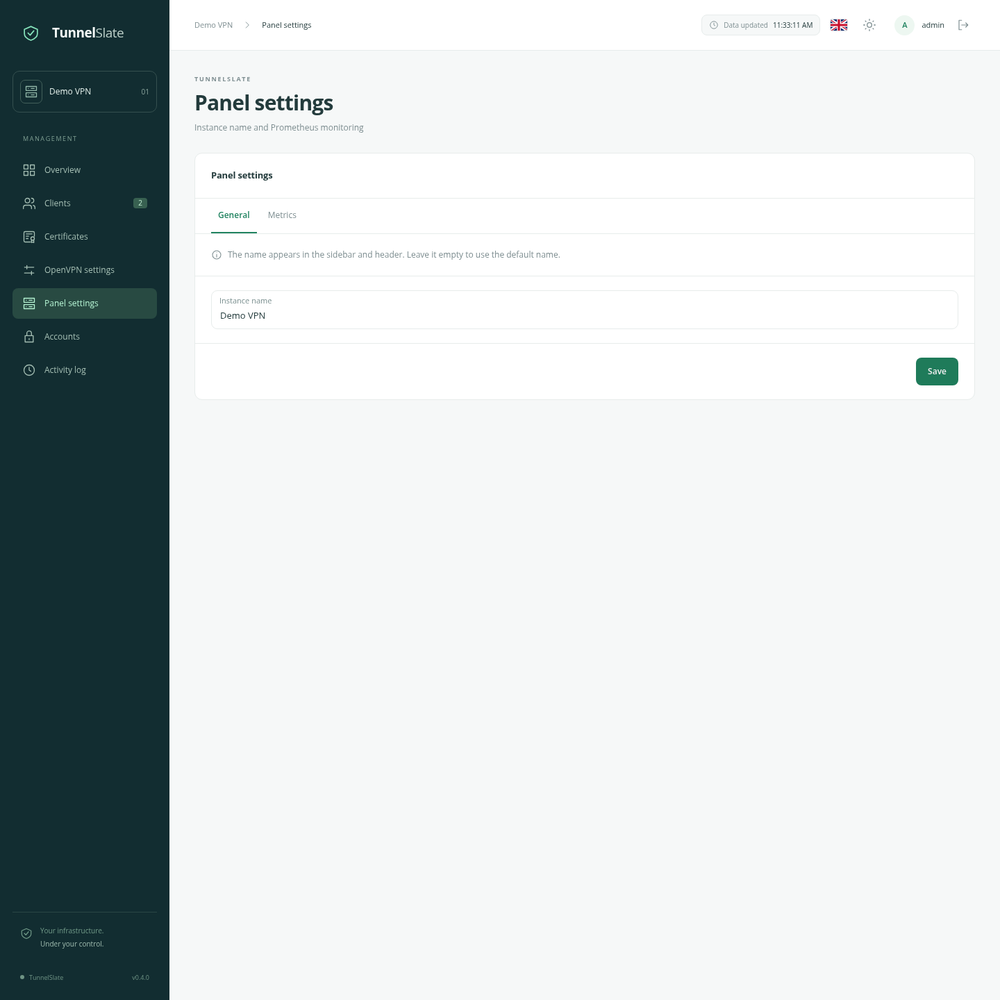
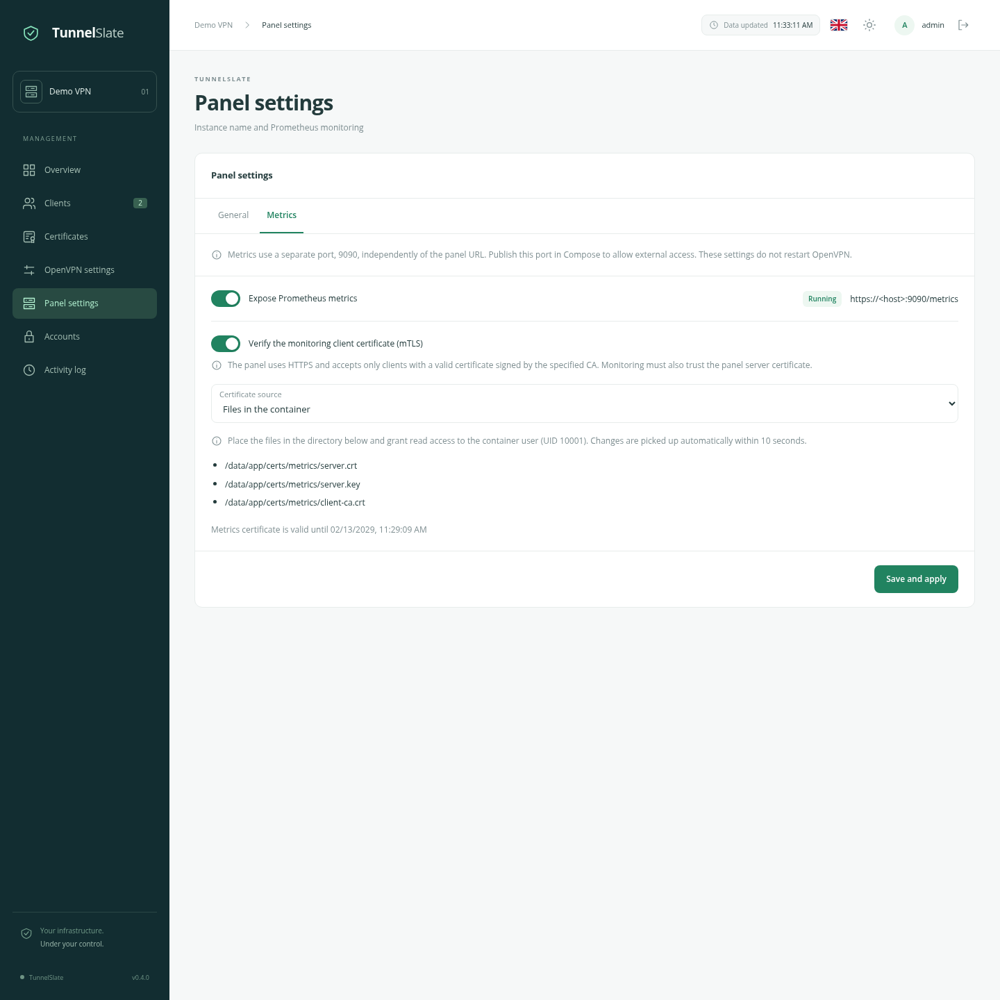
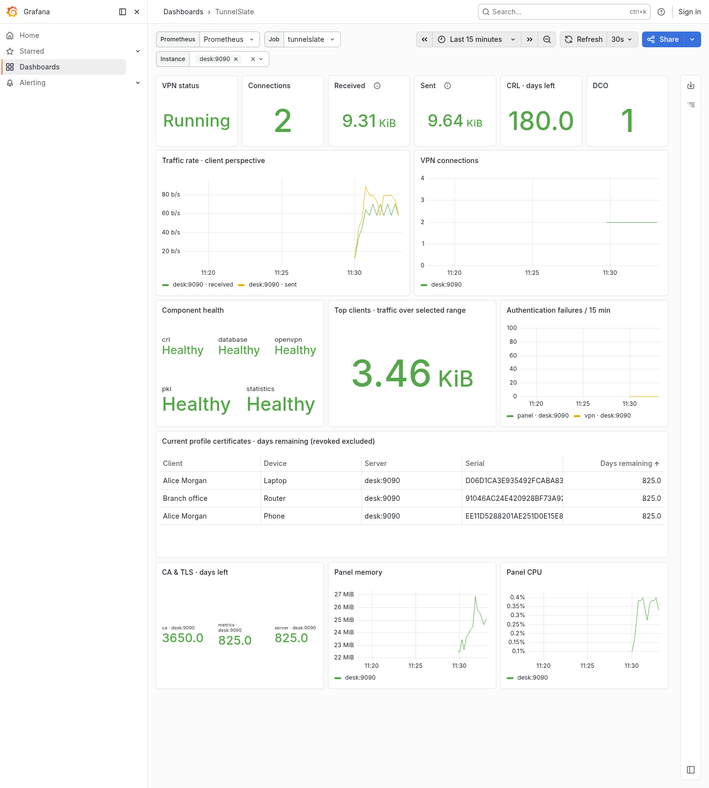

# Monitoring TunnelSlate

English · [Русский](/docs/MONITORING_ru.md) · [Overview](/docs/OVERVIEW_en.md) · [Quickstart](/docs/QUICKSTART_en.md)

## Panel settings

Open **Panel settings → General** to name the instance. The name appears in the sidebar and header for all administrators. An empty field restores the default “My server”.



## Enable metrics

Under **Metrics**, enable the endpoint and click **Save and apply**. Metrics are disabled by default: the application does not open their port.

Metrics use a dedicated port, **9090**, and the path **/metrics**. The panel URL, base path and nginx configuration do not change this address. Even with the panel under `/ovpn`, metrics remain at `/metrics` on port 9090. They are not exposed on the main panel port.

For Prometheus in the same Docker network, use `tunnelslate:9090`. For monitoring on the host, add this entry to the panel service's `ports`:

```yaml
- "127.0.0.1:9091:9090/tcp"
```

This example exposes host port **9091**, while the container still uses **9090**. Configure the address and port reachable from Prometheus; `127.0.0.1` inside a Prometheus container refers to Prometheus itself.

Apply Compose with `docker compose up -d`. For remote monitoring, bind to the monitoring interface instead of loopback and allow only your monitoring server. Applying metrics settings does not restart OpenVPN.

Without mTLS, the endpoint serves **HTTP without authentication**. Restrict access with the network or firewall. Metrics contain client and device names, but no passwords, profile links, private keys or session IPs.



## Protect metrics with mTLS

Enable **Verify the monitoring client certificate (mTLS)**. The endpoint switches to HTTPS and verifies the client certificate during the TLS handshake. nginx headers cannot replace this check.

Provide these PEM files:

| Panel input | Purpose |
| --- | --- |
| Server certificate and intermediate chain | Presented to Prometheus. Its SAN must contain the DNS name or IP used for server verification; it must permit TLS server authentication. |
| Unencrypted server private key | Must match the server certificate. |
| Monitoring client certificate CA | The panel accepts client certificates signed by this CA. Use a dedicated monitoring CA or account for all suitable certificates trusted through that CA. |

Prometheus needs its own client certificate and key. Its certificate must permit TLS client authentication. Prometheus must also trust the CA that signed the panel's server certificate. **Server and client CAs can be different.** The VPN CA is not automatically trusted here.

### Option 1: files

Select **Files in the container** and provide:

```text
/data/app/certs/metrics/server.crt
/data/app/certs/metrics/server.key
/data/app/certs/metrics/client-ca.crt
```

With standard bind mounts, the host directory is `./data/app/certs/metrics`. The application creates the directory and runs as UID/GID **10001:10001**. Assign the files to this owner, keep directories at `0700` and the key at `0600`; do not make the private key publicly readable. Click **Save and apply**.

Files are checked every 10 seconds. Prepare all three files before rotation and replace them without exposing partially written PEM. A successful rotation closes existing TLS connections so the former CA cannot retain access. If replacement material is invalid, the last working TLS configuration remains until corrected and the tab shows an error. Invalid material at startup leaves the port closed. TLS errors never enable an HTTP fallback.

### Option 2: PEM fields

Select **Paste PEM** and enter the server certificate, private key and monitoring client CA. The key is encrypted in the database and never returned to the browser when settings are opened. Leaving the key field empty on subsequent saves keeps the existing key.

`data/app/metrics.key` decrypts the key stored in the database. **Back up all of `data/app` together**: restoring the database without `metrics.key` cannot enable mTLS with the saved key. In file mode, the server key remains in the specified file.

Missing client certificates, certificates signed by another CA and expired client certificates are rejected during TLS authentication. Disabling metrics closes the listener and existing connections.

## Configure Prometheus

Ready-to-adapt examples:

- [HTTP](/deploy/monitoring/prometheus.http.yml.example).
- [HTTPS with mTLS](/deploy/monitoring/prometheus.mtls.yml.example).
- [Alert rules](/deploy/monitoring/alerts.yml).

Merge the job into your `scrape_configs`. For mTLS, mount the certificates into Prometheus and adjust `ca_file`, `cert_file`, `key_file` and `server_name`. The server name must match the server certificate SAN. Certificate verification can remain enabled.

The examples use job `tunnelslate`, a 30-second interval and a 15-second timeout. If you rename the job, also adjust `TunnelSlateMetricsUnavailable`. Paths in Prometheus configuration refer to its container. No changes to the panel's TLS reverse proxy are required.

## Available data

Certificate expiry values are Unix timestamps in seconds: `metric - time()` gives the remaining lifetime in seconds. Traffic is measured **from the VPN client's perspective**: `received` means received by the client; `sent` means sent by the client.

| Metric / family | Meaning |
| --- | --- |
| `up` | Prometheus reports whether scraping succeeded. A disabled endpoint yields 0. |
| `tunnelslate_build_info` | Panel version and configured `instance_name`. Prometheus retains its normal target `instance` label. |
| `tunnelslate_metrics_collection_success` | Whether the database and a sufficiently fresh OpenVPN snapshot were available. |
| `tunnelslate_snapshot_timestamp_seconds` | OpenVPN snapshot timestamp. |
| `tunnelslate_component_up` | Database, OpenVPN, PKI, CRL and statistics worker health, by `component`. |
| `tunnelslate_vpn_up`, `tunnelslate_vpn_connections` | OpenVPN availability and current connections. Unknown connection counts are omitted rather than reported as zero. |
| `tunnelslate_openvpn_info`, `tunnelslate_vpn_dco_active` | OpenVPN version and actual DCO use, when known. |
| `tunnelslate_vpn_traffic_bytes_total` | Independently persisted server traffic, by direction. |
| `tunnelslate_client_traffic_bytes_total`, `tunnelslate_profile_traffic_bytes_total` | Lifetime client and device traffic. |
| `tunnelslate_{vpn,client,profile}_sessions_total`, `tunnelslate_{vpn,client,profile}_duration_seconds_total` | Lifetime session counts and cumulative session durations in seconds. |
| `tunnelslate_profile_certificate_not_after_timestamp_seconds` | Current certificate expiry per device. Revoked and historical certificates are excluded; expired certificates remain until revoked or replaced. |
| `tunnelslate_profile_certificate_status` | Current profile certificate and status, including revocation, with client, device and serial labels. |
| `tunnelslate_certificate_not_after_timestamp_seconds` | CA, OpenVPN server and active metrics server certificate expiry, by `kind`. |
| `tunnelslate_crl_next_update_timestamp_seconds` | CRL expiry. |
| `tunnelslate_clients`, `tunnelslate_devices` | Non-deleted clients and devices. |
| `tunnelslate_authentication_failures_total` | Panel and external VPN authentication failures (`scope=panel/vpn`). Counting starts when monitoring support is installed and survives audit retention. Requests already rejected by the rate limiter are not additional password checks. |
| `tunnelslate_pki_operations` | Unfinished or failed PKI operations by kind and state. No series is emitted when none exist. |
| `tunnelslate_statistics_last_success_timestamp_seconds` | Last successful statistics ingestion pass. |
| `go_*`, `process_*` | Panel memory, CPU and Go runtime metrics. |

The collector uses the shared Management Interface snapshot and persisted statistics. It does not establish a new OpenVPN connection on every scrape. Traffic and health updates may lag by a few seconds. Lifetime counters are independent of session history retention; server totals survive client deletion.

Reissuing a profile replaces its current certificate serial in exported metrics. Deleted devices disappear from subsequent scrapes; Prometheus retains previously collected history according to its own retention. Device names and serials create separate time series, so account for their volume when sizing storage.

## Grafana and alerts

The [TunnelSlate dashboard](/deploy/monitoring/grafana/tunnelslate.json) uses **Classic JSON**. To load it in Grafana 13:

1. Open **Dashboards → New → Import**.
2. Upload the file through **Upload dashboard JSON file**. Alternatively, paste its contents into **Import via dashboard JSON model** and click **Load**.
3. Check the name and folder, then click **Import**.
4. Select your Prometheus datasource at the top of the imported dashboard. Job selects one specific job, without an All option; Instance selects one or more servers belonging to that job.

Grafana 13's **Edit as code** editor uses a different model, V2. Pasting Classic JSON there produces type errors: for example, Classic `annotations` is an object containing `list`, whereas V2 uses an array. Use **Import** for the supplied file; no manual changes to `annotations` are needed. [Grafana JSON model formats](https://grafana.com/docs/grafana/latest/visualizations/dashboards/build-dashboards/view-dashboard-json-model/).

The dashboard covers component health, connections, traffic rates and totals, top clients, authentication failures, certificate and CRL expiry, panel memory and CPU. Rate charts may remain empty until two scrapes have been collected. DCO “No data” means its state has not yet been reported.



Example rules warn 14 days before profile certificate expiry, 30 days before infrastructure certificate expiry and 7 days before CRL expiry. They also report unavailable VPN/metrics and stopped statistics ingestion. Adapt thresholds to your process. Configure notification delivery in Alertmanager; the dashboard itself does not send notifications.

References: [Prometheus TLS configuration](https://prometheus.io/docs/prometheus/latest/configuration/configuration/#tls_config), [exporter-toolkit security model](https://github.com/prometheus/exporter-toolkit/blob/master/docs/web-configuration.md).
