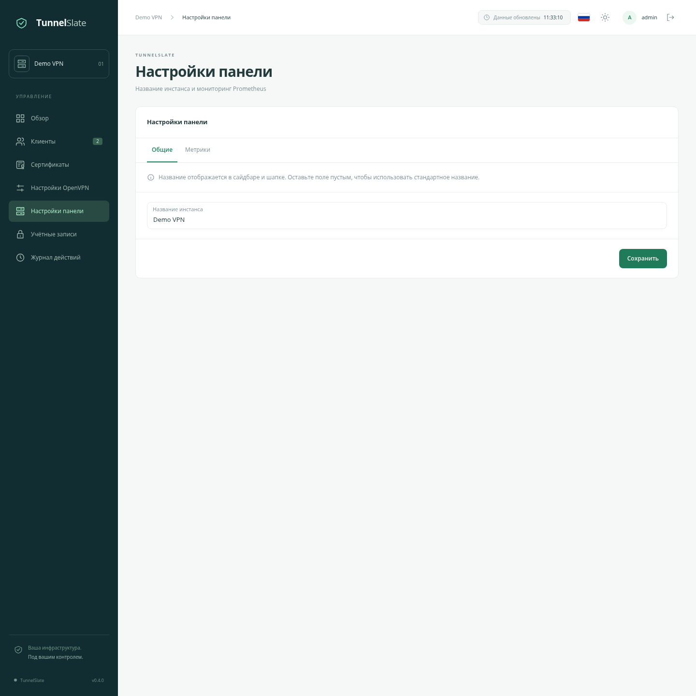
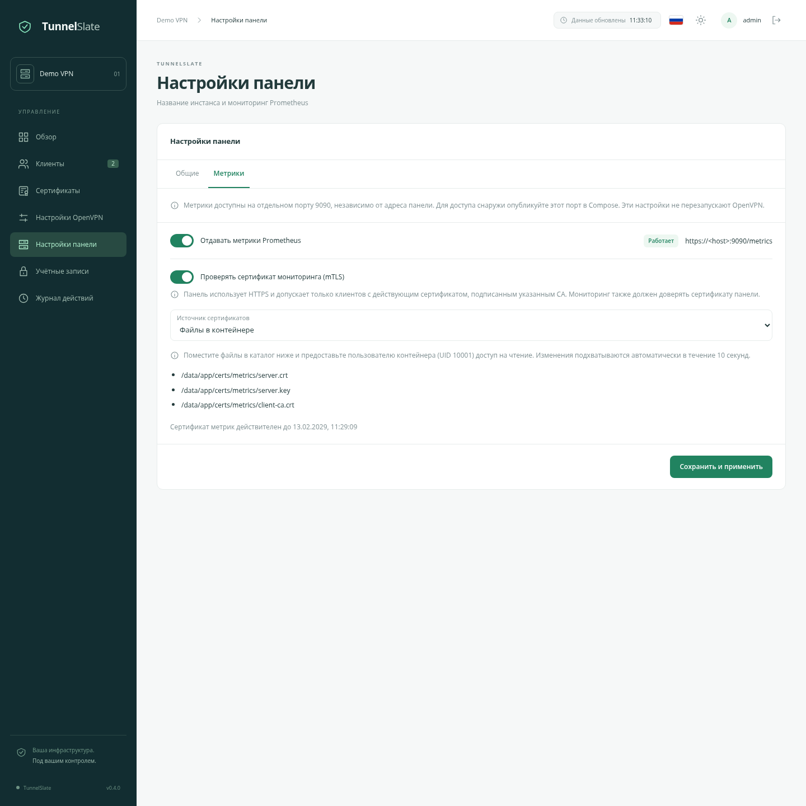
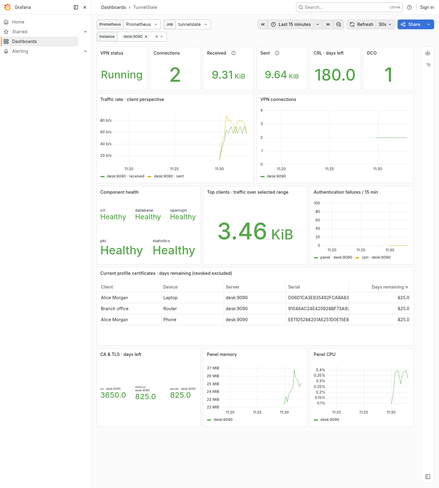

# Мониторинг TunnelSlate

Русский · [English](/docs/MONITORING_en.md) · [О проекте](/docs/OVERVIEW_ru.md) · [Быстрый старт](/docs/QUICKSTART_ru.md)

## Настройки панели

Откройте **Настройки панели → Общие**, чтобы задать название инстанса. Оно появится в сайдбаре и шапке. Пустое поле возвращает стандартное название «Мой сервер». Изменение видно всем администраторам.



## Включение метрик

На вкладке **Метрики** включите отдачу метрик и нажмите **Сохранить и применить**. По умолчанию метрики выключены: приложение не открывает для них порт.

Метрики доступны на отдельном порту **9090**, по пути **/metrics**. Адрес панели, её base path и настройки nginx на этот адрес не влияют. Например, при панели `/ovpn` путь метрик всё равно `/metrics`, на порту 9090. На основном порту панели метрики не публикуются.

Если Prometheus работает в той же Docker-сети, укажите `tunnelslate:9090`. Если он работает на хосте, добавьте в `ports` сервиса панели:

```yaml
- "127.0.0.1:9091:9090/tcp"
```

В этом примере на хосте метрики доступны по порту **9091**, а внутри контейнера — по **9090**. В Prometheus укажите адрес и порт, доступные именно ему; `127.0.0.1` внутри контейнера Prometheus относится к самому Prometheus.

Примените Compose командой `docker compose up -d`. Для удалённого мониторинга вместо loopback используйте адрес интерфейса мониторинга и разрешите доступ только нужному серверу. Изменение настроек метрик в панели не перезапускает OpenVPN.

Без mTLS endpoint работает по **HTTP без аутентификации**. Ограничьте его доступность сетью или firewall. Метрики содержат имена клиентов и устройств, но не пароли, ссылки на профили, ключи или IP сессий.



## Защита через mTLS

Включите **Проверять сертификат мониторинга (mTLS)**. Endpoint переключится на HTTPS и будет проверять клиентский сертификат при установлении TLS-соединения. Заголовки nginx не заменяют эту проверку.

Нужны три файла в формате PEM:

| Что предоставить панели | Назначение |
| --- | --- |
| Сертификат сервера с промежуточной цепочкой | Панель предъявляет его Prometheus. В SAN должно быть DNS-имя или IP, по которому мониторинг проверяет сервер; сертификат должен разрешать серверную TLS-аутентификацию. |
| Приватный ключ сервера без парольной защиты | Должен соответствовать серверному сертификату. |
| CA сертификатов мониторинга | Панель доверяет клиентским сертификатам, подписанным этим CA. Используйте отдельный CA для мониторинга либо учитывайте, что доступ получат все подходящие сертификаты доверенного CA. |

У Prometheus должны быть собственные клиентский сертификат и ключ. Клиентский сертификат должен разрешать клиентскую TLS-аутентификацию. Кроме того, Prometheus должен доверять CA серверного сертификата панели. **CA сервера и CA клиента могут быть разными.** VPN CA здесь не используется автоматически.

### Вариант 1: файлы

Выберите **Файлы в контейнере** и разместите:

```text
/data/app/certs/metrics/server.crt
/data/app/certs/metrics/server.key
/data/app/certs/metrics/client-ca.crt
```

При стандартных bind mounts на хосте это `./data/app/certs/metrics`. Приложение создаёт каталог само; оно работает с UID/GID **10001:10001**. Передайте файлы этому владельцу, оставьте каталоги с правами `0700`, ключ с `0600`; не делайте приватный ключ общедоступным. Нажмите **Сохранить и применить**.

Файлы перечитываются каждые 10 секунд. Для ротации подготовьте все три файла и замените их без частично записанных PEM. После успешной ротации старые TLS-соединения закрываются, чтобы прежний CA не сохранял доступ. Если новая пара некорректна, последняя рабочая TLS-конфигурация остаётся до исправления; ошибка отображается на вкладке. При первом запуске с ошибкой порт остаётся закрытым. Перехода на HTTP при ошибке TLS нет.

### Вариант 2: поля в панели

Выберите **Вставить PEM** и заполните сертификат сервера, ключ и CA мониторинга. Ключ сохраняется в БД зашифрованным и не возвращается в браузер при открытии настроек. Пустое поле ключа при следующем сохранении означает «сохранить текущий».

Файл `data/app/metrics.key` нужен для расшифровки ключа в БД. **Сохраняйте весь `data/app` вместе**: БД без `metrics.key` не позволит включить mTLS с сохранённым ключом. При выборе файлового варианта серверный ключ хранится в указанном файле.

Отсутствие сертификата клиента, чужой CA или просроченный клиентский сертификат приводят к отказу в TLS-доступе. При отключении метрик listener и существующие соединения закрываются.

## Подключение Prometheus

Готовые примеры:

- [HTTP](/deploy/monitoring/prometheus.http.yml.example).
- [HTTPS с mTLS](/deploy/monitoring/prometheus.mtls.yml.example).
- [Правила оповещения](/deploy/monitoring/alerts.yml).

Перенесите job в свой `scrape_configs`. Для mTLS подключите сертификаты в контейнер Prometheus и исправьте `ca_file`, `cert_file`, `key_file` и `server_name`. `server_name` должен совпадать с SAN серверного сертификата. Отключать проверку сертификата не требуется.

Примеры используют job `tunnelslate`, интервал 30 секунд и timeout 15 секунд. Если переименовали job, исправьте также правило `TunnelSlateMetricsUnavailable`. Пути в конфигурации Prometheus относятся к его контейнеру. Стандартный TLS reverse proxy панели менять не нужно.

## Какие данные доступны

Время окончания сертификатов отдаётся Unix timestamp в секундах: `metric - time()` показывает оставшийся срок в секундах. Трафик считается **со стороны VPN-клиента**: `received` — получено клиентом, `sent` — отправлено клиентом.

| Метрика / семейство | Что показывает |
| --- | --- |
| `up` | Сам Prometheus сообщает, удалось ли получить метрики. При выключенном endpoint — 0. |
| `tunnelslate_build_info` | Версия панели и заданное название инстанса (`instance_name`). Метка `instance` остаётся адресом цели Prometheus. |
| `tunnelslate_metrics_collection_success` | Удалось прочитать БД и получить достаточно свежий снимок OpenVPN. |
| `tunnelslate_snapshot_timestamp_seconds` | Время снимка OpenVPN. |
| `tunnelslate_component_up` | Состояние БД, OpenVPN, PKI, CRL и сборщика статистики; метка `component`. |
| `tunnelslate_vpn_up`, `tunnelslate_vpn_connections` | Доступность OpenVPN и активные подключения. При неизвестном состоянии число подключений не выдаётся как ноль. |
| `tunnelslate_openvpn_info`, `tunnelslate_vpn_dco_active` | Версия OpenVPN и фактическое использование DCO, если известны. |
| `tunnelslate_vpn_traffic_bytes_total` | Независимый накопленный трафик сервера по двум направлениям. |
| `tunnelslate_client_traffic_bytes_total`, `tunnelslate_profile_traffic_bytes_total` | Накопленный трафик клиента и устройства. |
| `tunnelslate_{vpn,client,profile}_sessions_total`, `tunnelslate_{vpn,client,profile}_duration_seconds_total` | Накопленное число сессий и суммарная длительность в секундах. |
| `tunnelslate_profile_certificate_not_after_timestamp_seconds` | Срок текущего сертификата каждого устройства. Отозванные и исторические сертификаты исключены. Истёкшие, но не отозванные остаются видны для алерта. |
| `tunnelslate_profile_certificate_status` | Текущий сертификат и статус, включая отзыв; метки клиента, устройства и serial. |
| `tunnelslate_certificate_not_after_timestamp_seconds` | Срок CA, сертификата сервера OpenVPN и активного сертификата метрик; метка `kind`. |
| `tunnelslate_crl_next_update_timestamp_seconds` | Срок CRL. |
| `tunnelslate_clients`, `tunnelslate_devices` | Количество неудалённых клиентов и устройств. |
| `tunnelslate_authentication_failures_total` | Ошибки входа в панель и внешней VPN-аутентификации (`scope=panel/vpn`). Счётчик начинается с установки поддержки метрик и переживает очистку аудита. Запросы, уже заблокированные лимитером, не считаются новыми проверками пароля. |
| `tunnelslate_pki_operations` | Незавершённые и неудавшиеся операции по виду и состоянию. При их отсутствии серии нет. |
| `tunnelslate_statistics_last_success_timestamp_seconds` | Последний успешный проход сборщика статистики. |
| `go_*`, `process_*` | Память, CPU и состояние Go-процесса панели. |

Сборщик использует общий снимок Management Interface и сохранённую статистику. Он не создаёт отдельное соединение с OpenVPN на каждый scrape. Обновление трафика и состояния может запаздывать на несколько секунд. Накопленные итоги не зависят от retention истории сессий, а серверный трафик сохраняется после удаления клиентов.

Перевыпуск заменяет serial текущего сертификата в метриках. Удалённые устройства исчезают из новых сборов; уже полученную историю Prometheus хранит по собственному retention. Имена и serial дают отдельные ряды для устройств: учитывайте их количество при настройке хранения.

## Grafana и оповещения

Файл [dashboard TunnelSlate](/deploy/monitoring/grafana/tunnelslate.json) использует формат **Classic JSON**. Для загрузки в Grafana 13:

1. Откройте **Dashboards → New → Import**.
2. Загрузите файл через **Upload dashboard JSON file**. Либо вставьте его содержимое в **Import via dashboard JSON model** и нажмите **Load**.
3. Проверьте название и папку, затем нажмите **Import**.
4. В открывшемся dashboard выберите источник Prometheus в верхнем списке. В Job выбирается одна конкретная job без варианта All; Instance позволяет выбрать один или несколько её серверов.

В редакторе **Edit as code** Grafana 13 используется другая модель — V2. Вставка туда Classic JSON вызывает ошибки типов: например, в Classic поле `annotations` содержит объект с `list`, а в V2 — массив. Для поставляемого файла используйте **Import**; менять `annotations` вручную не нужно. [Описание форматов JSON в Grafana](https://grafana.com/docs/grafana/latest/visualizations/dashboards/build-dashboards/view-dashboard-json-model/).

Dashboard показывает доступность компонентов, подключения, скорость и общий объём трафика, активность клиентов, ошибки аутентификации, сроки сертификатов и CRL, память и CPU панели. До накопления двух scrape графики скорости могут быть пустыми. «No data» у DCO означает, что сервер ещё не сообщил его состояние.



В примере правил есть предупреждения за 14 дней до окончания сертификата профиля, за 30 дней для инфраструктурных сертификатов и за 7 дней для CRL, а также недоступность VPN/метрик и остановка сбора статистики. Адаптируйте пороги под свой процесс. Доставку уведомлений настройте в Alertmanager; dashboard сам их не рассылает.

Справочные материалы: [TLS-настройки Prometheus](https://prometheus.io/docs/prometheus/latest/configuration/configuration/#tls_config), [модель защиты exporter-toolkit](https://github.com/prometheus/exporter-toolkit/blob/master/docs/web-configuration.md).
