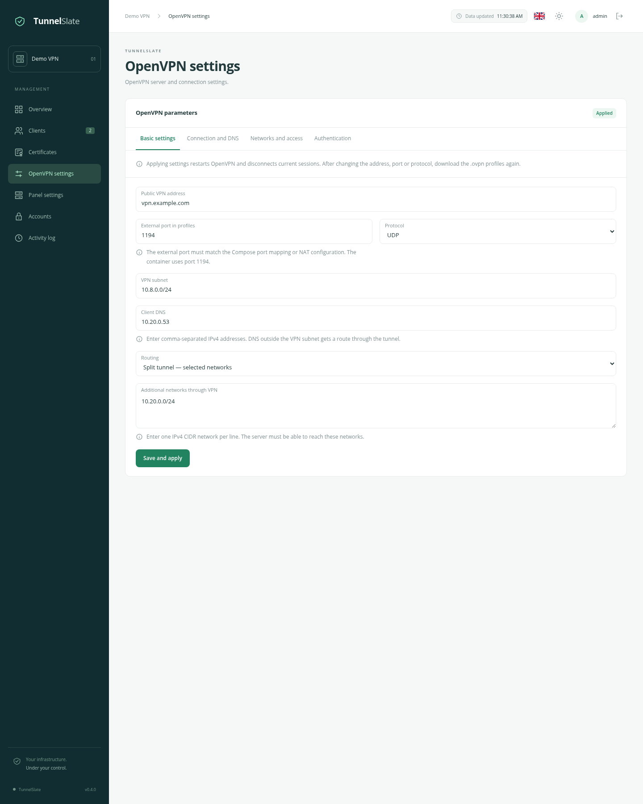
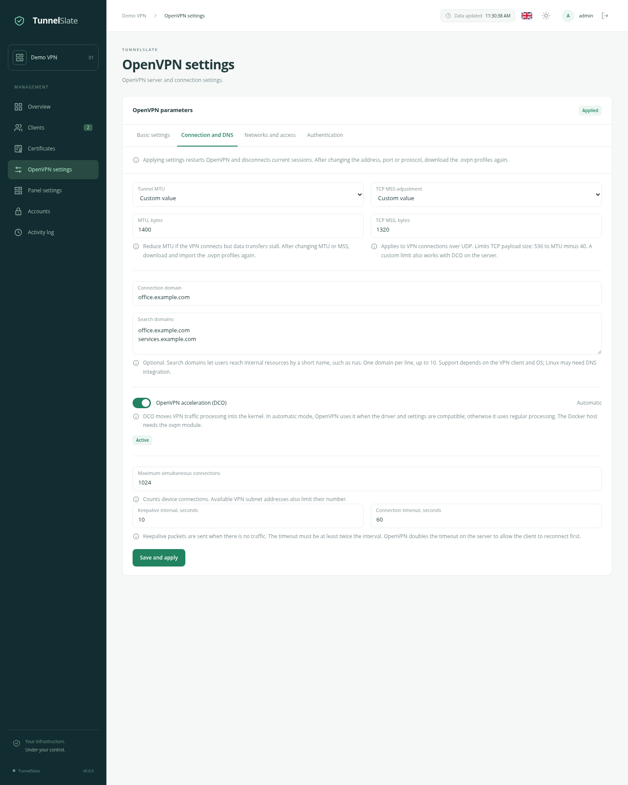
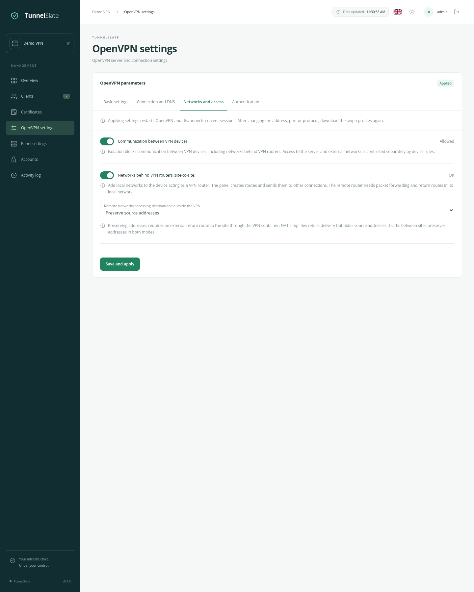
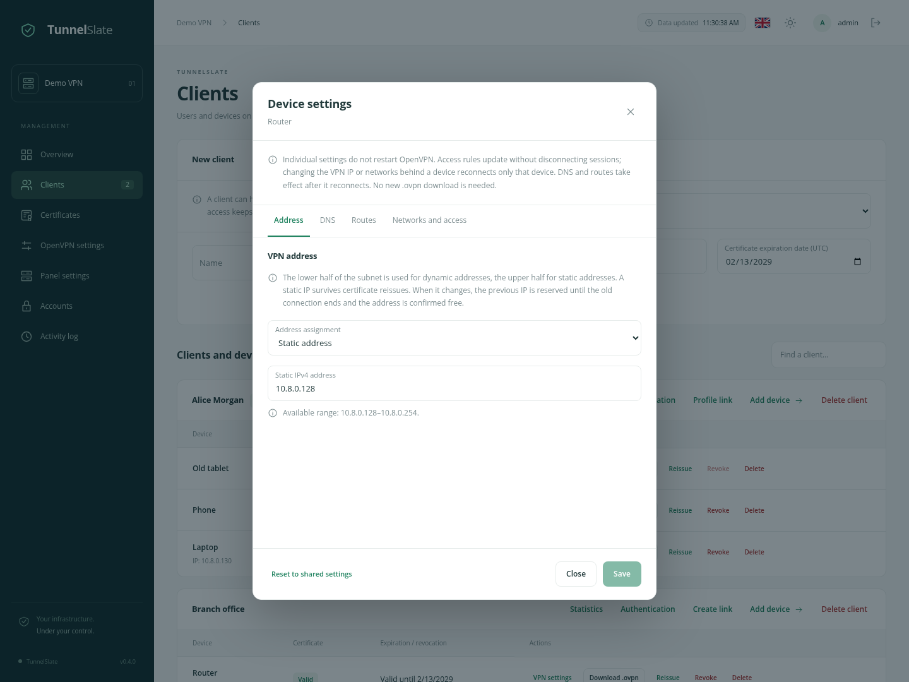
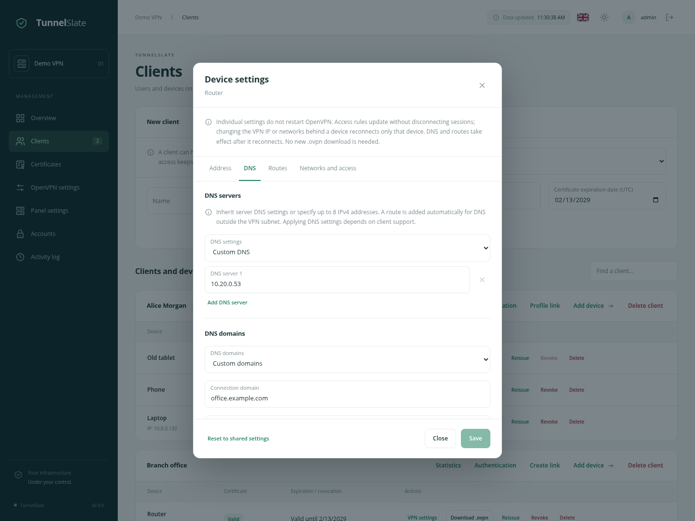
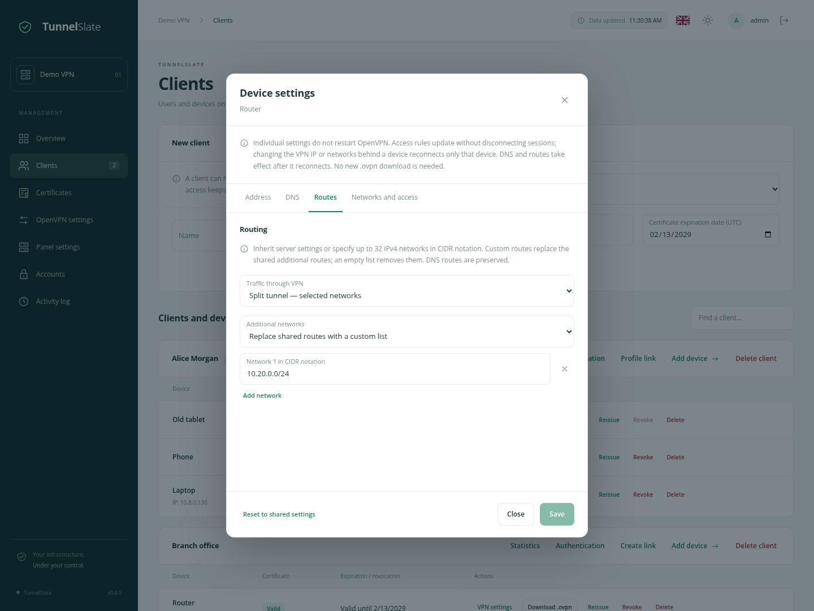
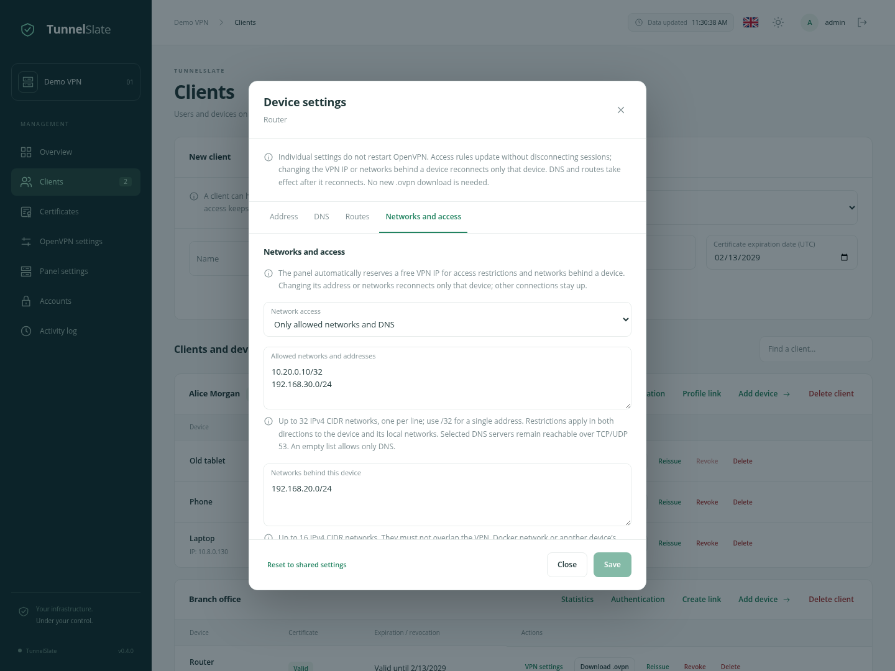

# OpenVPN settings

English · [Русский](/docs/OPENVPN_SETTINGS_ru.md) · [About the project](/docs/OVERVIEW_en.md) · [Quickstart](/docs/QUICKSTART_en.md)

This guide covers the settings available in TunnelSlate: what each field changes, how shared and per-device options interact, and what users need to do after you save changes.

- [Applying changes](#apply)
- [Basic settings](#basic)
- [Connection and DNS](#connection)
- [Networks and access](#networks)
- [Authentication: LDAP and RADIUS](#authentication)
- [Per-device settings — CCD](#devices)
- [Certificate expiry](#certificates)
- [Configuration examples](#examples)
- [Troubleshooting](#troubleshooting)

## Applying changes

Open **OpenVPN settings**. Server parameters use three tabs; **Save and apply** saves changes from all three. A separate fourth tab, **Authentication**, contains LDAP/RADIUS providers, saved in their own dialogs. Switching tabs before saving keeps the values you have entered.

Applying shared settings restarts OpenVPN and interrupts current connections. Devices with valid profiles usually reconnect automatically. The **Applied** badge means the VPN container has acknowledged the configuration; otherwise application is pending. Network policy errors appear under Networks and access: correct the problem and save again.

| Change | What to do on the device |
| --- | --- |
| Public address, external port, or protocol | Download a fresh `.ovpn`, replace the imported profile, and reconnect. |
| MTU or MSS mode/value | Download and import a fresh `.ovpn` so the client and server use matching options. |
| DNS, DNS domains, routes, split/full tunnel, or keepalive | Reconnect: the server sends these options when a connection is established. |
| Isolation, allowed networks, site-to-site, or NAT | Wait for application and reconnection; no new `.ovpn` is required. |
| Fixed VPN IP or per-device DNS/routes | DNS and routes update on the next connection; an IP change reconnects only this device. The server keeps running. |
| Reissued certificate | Download a new `.ovpn`: the old certificate has been revoked. |

On a new installation, check and save basic settings first, then initialize PKI in the panel. This creates the certificate authority and server certificate. OpenVPN waits until setup is complete. Initialization does not replace an existing PKI; incomplete keys and certificates must be recovered from saved data.

## Basic settings

### Public VPN address

A server name or IP address reachable by devices, such as `vpn.example.com`. Enter only the name or address, without `https://`, a path, or a port. This is the VPN endpoint; it can differ from the panel address.

The value is included in downloaded profiles. It does not create DNS records or change host networking. If the server is behind a router, configure DNS and port forwarding separately. The initial suggestion comes from the panel address; check it before issuing profiles.

### External port in profiles

The port devices connect to, from **1 to 65535**. It must match the externally reachable port in Compose or on your router. OpenVPN listens on **1194** inside the VPN container.

For example, with a `1195:1194/udp` mapping, enter `1195` and select UDP in the panel. Editing this field updates profiles but does not change Docker port publishing. Likewise, update the panel after changing the external port in Compose.

### Protocol

**UDP** is the initial choice for ordinary use. Choose **TCP** if the networks your devices connect from block UDP. Port publishing must match the selected protocol.

This is one VPN server using one selected protocol. Publishing both UDP and TCP in Compose does not start two listeners. The panel's MSS adjustment applies only to VPN connections over UDP.

### VPN subnet

The internal address range for VPN devices, initially `10.8.0.0/24`. Keep it separate from the Docker network, networks reached through the VPN, and users' local networks. Overlapping addresses can cause a device to send traffic to its local network instead of the VPN.

The panel accepts **IPv4 CIDR prefixes from /1 to /29**. The subnet size limits the number of available addresses; `/24` is usually enough for a small installation. The lower half is used for dynamic connections and the upper half for fixed addresses, excluding the gateway and reserved addresses.

With `10.8.0.0/24`, the dynamic range is **10.8.0.2–10.8.0.127** and the fixed range is **10.8.0.128–10.8.0.254**. If assigned IPs or device networks are incompatible with a new subnet, saving is rejected. Adjust those devices first.

### DNS servers

IPv4 DNS server addresses to send to connected devices. Enter **1–8 comma-separated addresses**, for example `10.20.0.53, 10.20.0.54`. Choose servers reachable from the VPN; the field does not start a DNS service.

You can use a DNS service on the host or elsewhere in your infrastructure. It must listen on a reachable address and accept queries from these devices. The panel sends routes to DNS servers outside the VPN subnet so they also work in split tunnel; the firewall and DNS service must allow the traffic too.

Whether pushed DNS is applied depends on the operating system and VPN client. Linux may require OpenVPN integration with the system resolver. If a resource opens by IP but not by name, check DNS first.

### Routing

**Split tunnel — selected networks:** VPN networks, pushed routes, and routes to selected DNS servers use the VPN. Other traffic generally uses the device's normal connection.

**Full tunnel — all IPv4 traffic:** the server asks the device to send all IPv4 traffic through the VPN, including internet access. This does not cover IPv6: its routing and potential bypass of the VPN need separate client and network configuration.

Routing chooses a path, not access permissions. A device can add its own route; use Networks and access restrictions when you need to block traffic.

### Additional networks through VPN

Networks whose routes the server sends to devices. Enter up to **32 IPv4 CIDR networks**, one per line, such as `10.20.0.0/24`. Use `/32` for a single host, such as `10.20.0.10/32`.

This is useful for reaching a central LAN in split tunnel. The VPN server needs a path to that network, and its hosts must be able to reply. This field does not create a LAN, configure a remote router, or grant firewall permissions. For a network **behind a VPN device**, use Networks behind this device in its editor rather than just a shared route.

## Connection and DNS

### Tunnel MTU

MTU sets the maximum IP packet size inside the tunnel. The default is **1500 bytes**; a custom value can be **576–1500 bytes**.

Consider changing MTU when the VPN connects but large responses and transfers stall, especially with other tunnels along the path. For example, try `1400`, reimport profiles, and compare the affected resource. An unnecessarily small value adds overhead; there is no single best value for every network.

### TCP MSS adjustment

Limits the TCP payload size carried through the VPN. It can help when HTTPS connections stall while small packets pass normally.

| Mode | Behavior |
| --- | --- |
| OpenVPN default | The panel sets no custom limit; OpenVPN's behavior applies. This is the initial mode. |
| Custom value | A limit from **536 to MTU minus 40 bytes**. With MTU 1400, the maximum is 1360. The server enforces it in both directions, including with DCO. |
| Disabled | The panel applies no custom adjustment and disables `mssfix` in generated profiles. Operating system and client application limits remain. |

This setting applies to **UDP VPN transport** and affects TCP traffic inside it; it does not limit UDP datagram sizes. With TCP VPN transport, the value is saved but not applied. Download and reimport profiles after changing MTU/MSS.

### Connection domain and search domains

**Connection domain** is an optional DNS domain sent to devices, such as `office.example.com`. Its exact use depends on the operating system and VPN client.

**Search domains** expand short names: with `office.example.com`, a lookup for `nas` may become `nas.office.example.com`. DNS still needs a record for that full name. Enter up to **10 domains**, one per line. Empty fields send no domain options.

Use ASCII letters, digits, and hyphens in DNS names; use punycode for international domains. These fields do not create DNS records, restrict website access, or configure split DNS. The client must support the options.

### DCO

DCO moves VPN traffic processing into the host kernel and may reduce CPU load. The switch selects a mode:

- **On — automatic:** OpenVPN uses DCO when the driver and configuration are compatible; otherwise it uses the regular path.
- **Off:** DCO is explicitly disabled.

The badge shows the actual applied state, rather than simply reflecting the switch:

| Status | Meaning |
| --- | --- |
| Active | OpenVPN reports that it is using DCO. |
| Disabled | Acceleration is disabled in the applied settings. |
| Not in use | The VPN runs without DCO. Check the driver, configuration compatibility, and VPN container logs if you expected acceleration. |
| Unknown | The actual state has not been received, for example because the server is not yet reachable. |

The host kernel version appears under DCO in **Overview → System status**, when available. Module installation is covered in the [administration guide](/docs/ADMINISTRATION_en.md#installing-dco-on-the-host). The panel's isolation and network restrictions work both with and without DCO.

### Connection limit

The maximum number of simultaneous VPN device connections: **1–65535**, default **1024**. This counts connections, not clients or administrators. Actual capacity is also limited by subnet addresses, the split between dynamic and fixed pools, and host resources. Raising the limit does not enlarge the subnet.

### Keepalive interval and timeout

**Keepalive interval** is how often a keepalive packet is sent when there is no other traffic: **1–3600 seconds**, default **10**.

**Timeout** is how long a client can receive no packets before reconnecting: default **60 seconds**, at least twice the interval and no more than **86400 seconds**. OpenVPN uses twice this timeout on the server so the client can reconnect first.

Lower values detect failures sooner but create more background traffic and may trigger unnecessary reconnects on unstable links. The initial values usually need no adjustment.

## Networks and access

### Communication between VPN devices

The switch allows communication when on and blocks it when off. Communication is allowed by default. Blocking it enables **global isolation**: devices cannot reach each other through the VPN. This includes devices belonging to the same client and LANs behind VPN routers.

Isolation takes precedence over per-device permissions. Allowing the other site's network will not open communication while global isolation is enabled. Access to the VPN server itself and destinations outside the VPN is controlled separately by device restrictions and other firewall rules.

### Networks behind VPN routers — site-to-site

Disabled by default. Enable it when a device connects an entire LAN to the VPN, such as an office router with LAN `192.168.20.0/24`.

The shared switch enables those networks. List each router's own subnets separately in its device editor. The panel binds them to the device certificate, creates routes on the VPN server, and sends routes to other connections. An arbitrary device cannot claim another device's network.

Use **distinct, non-overlapping subnets**: up to **16 per device** and **256 per installation**. They must not overlap the VPN subnet, connected Docker networks, or another device's networks. Assignments remain reserved for temporarily offline or revoked devices too.

The remote router must forward IPv4 packets, allow the required traffic in its firewall, and provide a return path from its LAN. The panel does not enable these features on remote hardware. The simplest arrangement uses the VPN router as the LAN's main gateway; otherwise the main gateway needs routes through it.

Disabling site-to-site keeps assignments but blocks access to them. Revoking a router certificate also blocks its LAN. To restore access, reissue the certificate and provide the new profile; you do not need to recreate network settings.

### Remote network egress

The selector is disabled and visually muted while site-to-site is off. Available when site-to-site is enabled, it controls how site networks reach destinations **outside the VPN**:

| Option | When to use it |
| --- | --- |
| Preserve source addresses | Central servers see the original site LAN addresses. They need return routes through the VPN container. This is the initial option. |
| NAT | Replaces the source with the VPN container address when traffic leaves for an external network. Simplifies replies from central servers but hides individual site devices. |

**Traffic between sites keeps original addresses in both modes.** This option does not change split/full tunnel for ordinary VPN devices or replace remote router setup. A physical central LAN may also need routes and firewall adjustments on the Docker host.

## Authentication: LDAP and RADIUS

Devices use individual certificates by default. Add LDAP and RADIUS providers in **Authentication**, then enable external password verification from client cards. All modes work together on one VPN server; a device certificate remains required.

The [LDAP/RADIUS guide](/docs/VPN_AUTH_en.md) covers provider fields, user/group filters, login tests, client-wide policies, secret protection and behaviour when external servers are unavailable.

## Per-device settings — CCD

Open **Clients**, find the client and click **VPN settings** beside the device.

CCD means settings for an individual VPN connection. They belong to a **device**, rather than the whole client record: one person's phone and laptop can receive different settings. Certificate reissues preserve them.

The editor has **Address**, **DNS**, **Routes** and **Networks and access** tabs. Values are retained when switching tabs. A shared **Save** button saves changes from every tab; an invalid required field opens its tab. Resetting restores shared defaults across all tabs.

Individual changes do not restart the server or disconnect other clients. Access rules apply to current traffic without reconnecting. Changing a device’s VPN IP or site networks reconnects only that device. DNS, domains and pushed routes update on its next connection. After adding or removing a site-to-site network, other devices stay connected and receive the new route list on their next connection. No new `.ovpn` download is needed.

### Address assignment

**Automatic:** an address is assigned from the dynamic pool; do not depend on it remaining unchanged.

**Static address:** enter a free address from the range shown by the editor. It remains assigned to the device. Duplicate or out-of-range values are rejected; after a change, the old address may remain reserved briefly while the old connection finishes.

Access restrictions or networks behind a device require a fixed address. If one is not already assigned, the panel picks an available address automatically. Selecting automatic mode does not remove the reservation while these policies remain configured.

### DNS servers and DNS domains

DNS servers and domains are inherited **independently**:

| Setting | Inherit | Custom values |
| --- | --- | --- |
| DNS servers | Shared servers from Basic settings. | Replace them with 1–8 reachable IPv4 addresses. |
| Connection and search domains | Shared domain and search list. | Replace both with custom values; empty custom fields remove shared domains for this device. |

You can keep shared DNS servers but use a different search domain, or the reverse. The panel also sends the necessary routes for custom DNS. The server must still be reachable and accept queries.

### Device routing

**Traffic through VPN:** inherit the shared mode, or select split or full tunnel independently of other devices.

**Additional networks:** inherit shared routes or replace them with a custom list of up to **32 IPv4 CIDR networks**. An empty custom list removes shared additional routes. Routes to selected DNS servers and enabled site-to-site networks are retained. A VPN router's own LAN is not routed back into its tunnel.

Removing a route does not block access. Use allowed networks in the following section to enforce a restriction.

### Access mode and allowed networks

**No individual restrictions:** no additional per-device restrictions; global isolation and other firewall rules still apply. This is the initial mode.

**Only allowed networks and DNS:** traffic in both directions is limited to the listed networks. Up to **32 IPv4 CIDR entries**, one per line; use `/32` for a single address. For example, `10.20.0.10/32` allows communication with that host. Restrictions cover both the device's VPN IP and the LANs behind it.

The device's selected DNS servers are additionally allowed over **TCP/UDP 53**, including replies. An empty allowed-network list leaves only this DNS access. Adding the DNS server itself to allowed networks also permits its other ports.

Permissions currently cover all protocols and ports for each listed address range. There is no field to allow only HTTPS. When two restricted devices need to communicate, both policies must allow the other side. Global isolation always takes precedence.

### Networks behind this device

Local IPv4 subnets reachable **through this device**, such as `192.168.20.0/24` behind an office router. This is not a list of destinations the device is allowed to access.

An ordinary phone or laptop usually does not need this field. For a router, enter up to **16 non-overlapping subnets** and enable shared site-to-site. The panel validates the networks and reserves a VPN IP; configure the remote LAN and gateway separately as described above.

### Reset to shared settings

The button resets values **in the form**: fixed IP, custom DNS/domains, routes, tunnel mode, restrictions, and networks behind the device. Click **Save** to apply. Closing without saving does not reset the active configuration. If this device was a site router, saving the reset removes its LAN from site-to-site.

## Certificate expiry

When creating a device or reissuing its certificate, choose when access ends. The form initially selects **today + 825 days**; replace it for temporary access.

The selected date is inclusive, ending at **23:59:59 UTC**. Certificate dates are also displayed in UTC; account for the difference from your local time when planning access expiry. Expiry cannot be in the past or later than the certificate authority's expiry.

Reissue creates a new certificate with the newly selected expiry and revokes the old one. The old certificate's original expiry remains in history after revocation, but no longer grants access. Client certificates are not renewed automatically; automatic CRL renewal extends the revocation list, not the certificates.

## Configuration examples

### Access internal services only

1. Choose split tunnel in Basic settings.
2. Add a network such as `10.20.0.0/24` under additional networks.
3. Set reachable DNS servers if internal services are accessed by name.
4. Save and reconnect the device.

Its ordinary internet connection stays outside the VPN. To restrict access to just this network, also add it to the device's allowed networks. Split tunnel alone does not enforce a restriction.

### Give a contractor access to one server

1. Create a separate device and select the access expiry date.
2. In its editor, choose split tunnel and a custom route `10.20.0.10/32`.
3. Select Only allowed networks and DNS, then add `10.20.0.10/32`.
4. Save, wait for application, and provide the contractor's profile.

The panel reserves a fixed VPN IP automatically. Selected DNS remains separately accessible. Restricting ports on the destination server requires an additional firewall rule.

### Connect two sites through one VPN server

1. Use different LANs, for example `192.168.20.0/24` and `192.168.30.0/24`, with VPN subnet `10.8.0.0/24`.
2. Create a separate router device for each site.
3. Enable site-to-site and keep communication between VPN devices allowed.
4. In each router editor, enter only its own LAN under Networks behind this device.
5. If using restrictions, allow the opposite LAN in each router's policy.
6. Configure routing, firewall, and return paths on remote routers; import their profiles and connect them.

Return paths inside both LANs are necessary for inter-site communication. If sites also need a central physical network, select NAT or configure return routes to the sites in central infrastructure. Do not share one profile between two routers.

## Troubleshooting

| Symptom | First checks |
| --- | --- |
| Cannot connect to the VPN | Check the public address, port, protocol, Docker/router publication, and certificate validity/status. Reimport a fresh profile after endpoint or protocol changes. |
| IP works but names do not | Check DNS reachability, its firewall, and whether the client applies pushed DNS. A search domain does not replace a DNS record. |
| Small requests work but transfers stall | Check MTU/MSS; update the client profile after changing them. |
| Another VPN device or site is unreachable | Check global isolation, permissions on both sides, and their routes. |
| A router's LAN is unreachable | Check site-to-site, Networks behind this device, a valid certificate, IPv4 forwarding, router firewall, and LAN return routes. |
| Settings remain pending | Check Networks and access for an error. Check the VPN container state and logs: `docker compose logs --tail=100 tunnelslate-vpn`. |
| DCO is not in use | Check the selected mode, the Docker host module, and VPN container logs. The host kernel and actual state appear in Overview. |

This guide describes the panel's fields. For the underlying directives, see the [official OpenVPN 2.7 manual](https://openvpn.net/community-docs/community-articles/openvpn-2-7-manual/).
