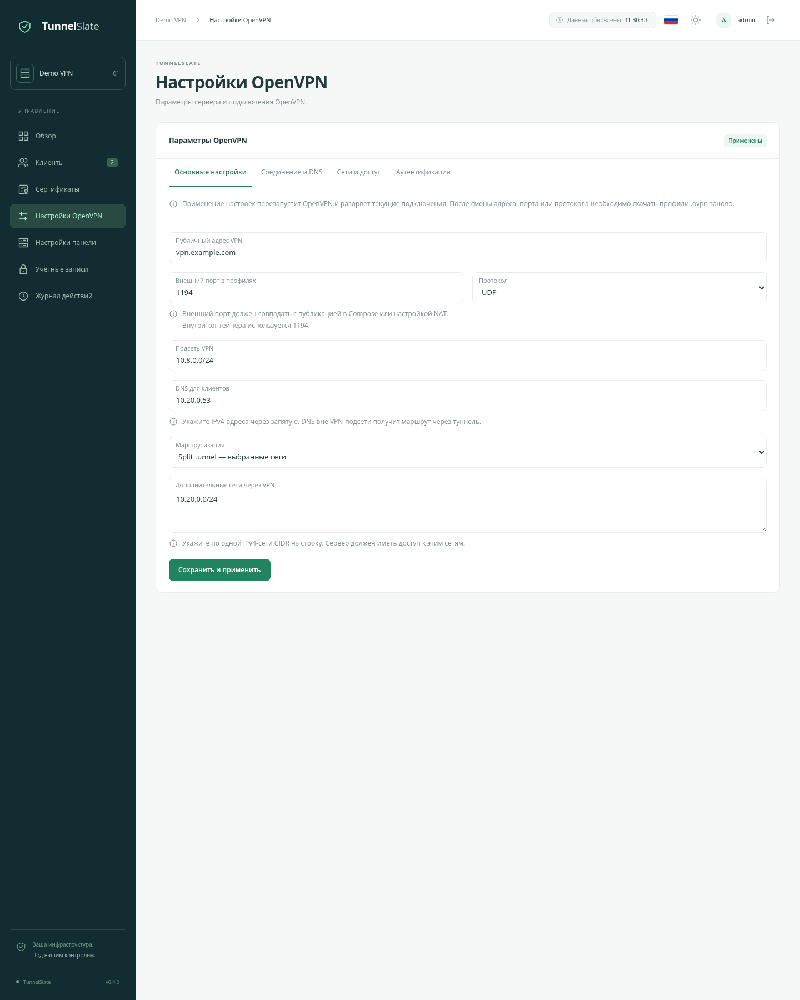
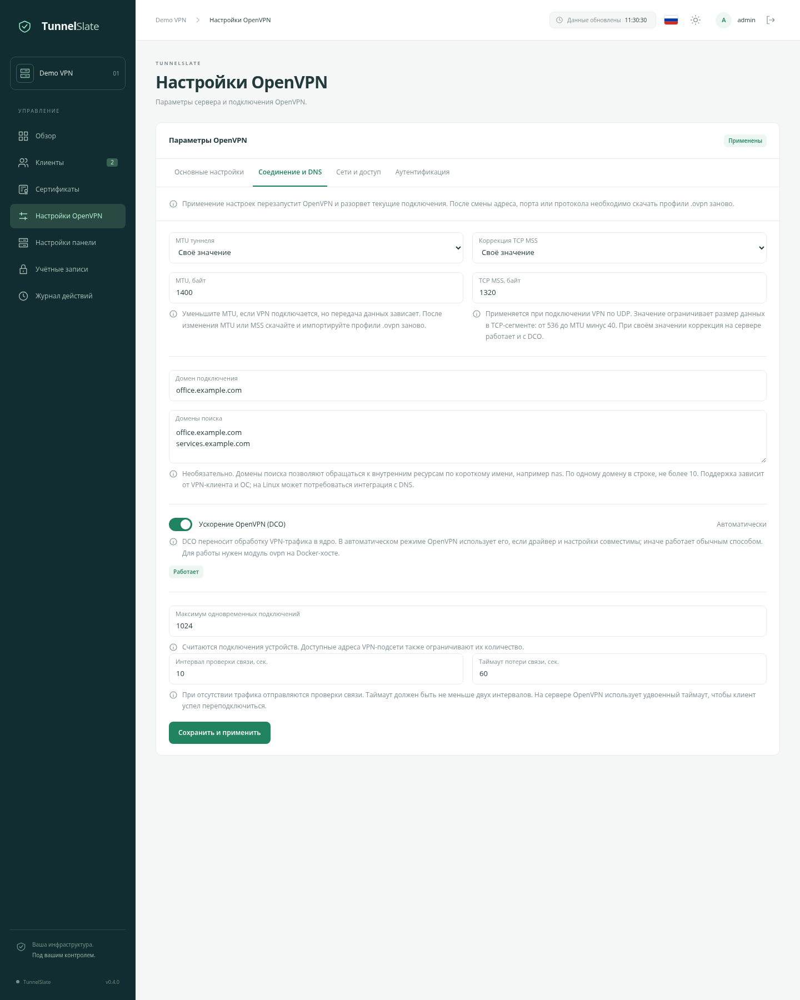
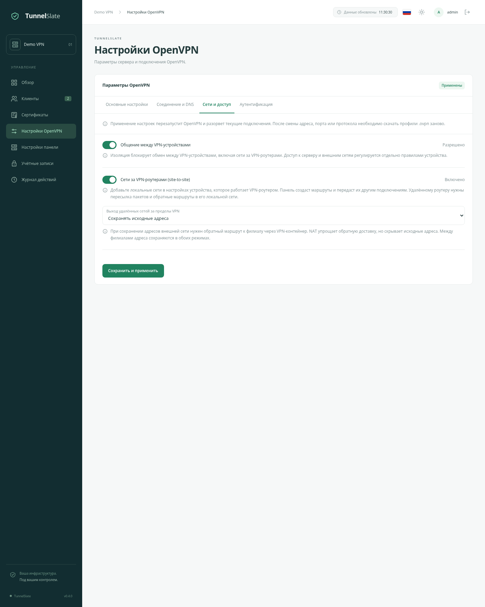
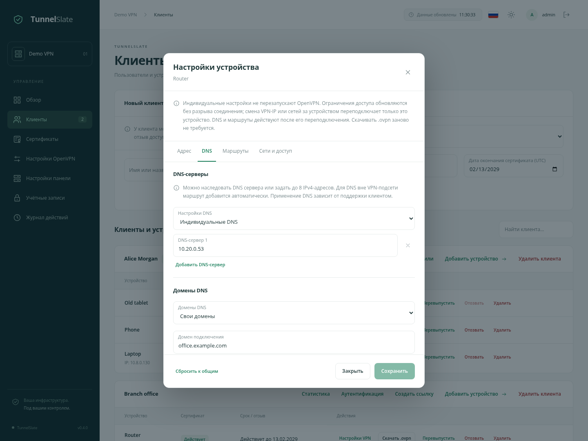
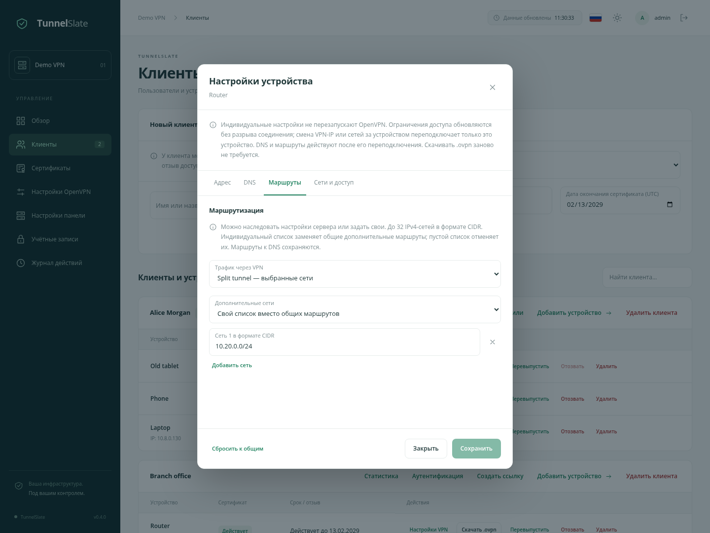
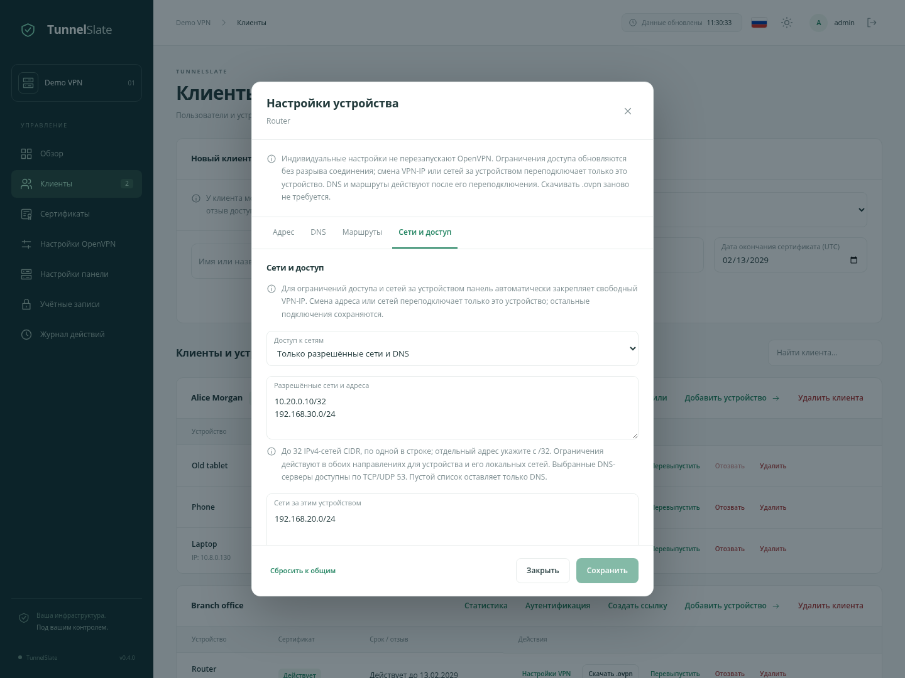

# Настройки OpenVPN

Русский · [English](/docs/OPENVPN_SETTINGS_en.md) · [О проекте](/docs/OVERVIEW_ru.md) · [Быстрый старт](/docs/QUICKSTART_ru.md)

Это руководство по настройкам, доступным в TunnelSlate: что меняет каждое поле, как сочетаются общие и индивидуальные параметры и что нужно сделать на устройствах после сохранения.

- [Как применять изменения](#apply)
- [Основные настройки](#basic)
- [Соединение и DNS](#connection)
- [Сети и доступ](#networks)
- [Аутентификация: LDAP и RADIUS](#authentication)
- [Индивидуальные настройки устройства — CCD](#devices)
- [Срок действия сертификата](#certificates)
- [Примеры настройки](#examples)
- [Если что-то не работает](#troubleshooting)

## Как применять изменения

Откройте **«Настройки OpenVPN»**. Параметры сервера разделены на три вкладки; кнопка **«Сохранить и применить»** сохраняет их изменения сразу. Отдельная четвёртая вкладка **«Аутентификация»** содержит провайдеров LDAP/RADIUS, которые сохраняются в собственных окнах. До нажатия кнопки переключение между ними не сбрасывает введённые значения.

Применение общих настроек перезапускает OpenVPN и разрывает текущие подключения. Устройства с действующими профилями обычно переподключаются сами. Бейдж **«Применены»** означает, что VPN-контейнер подтвердил применение; пока подтверждения нет, отображается ожидание. Ошибка сетевой политики показывается во вкладке «Сети и доступ»: исправьте её и сохраните настройки ещё раз.

| Что изменилось | Что сделать на устройстве |
| --- | --- |
| Внешний адрес, внешний порт или протокол | Скачать свежий `.ovpn`, заменить импортированный профиль и подключиться заново. |
| MTU или режим/значение MSS | Скачать и импортировать свежий `.ovpn`, чтобы клиент и сервер использовали согласованные параметры. |
| DNS, DNS-домены, маршруты, режим split/full tunnel, keepalive | Переподключиться: параметры передаются сервером при подключении. |
| Изоляция, разрешённые сети, site-to-site или NAT | Дождаться применения и переподключения; новый `.ovpn` не требуется. |
| Постоянный VPN-IP или индивидуальные DNS/маршруты устройства | DNS и маршруты — при следующем подключении; смена IP переподключает только это устройство. Сервер продолжает работать. |
| Сертификат перевыпущен | Скачать новый `.ovpn`: прежний сертификат отозван. |

При первом запуске сначала проверьте основные настройки и сохраните их, затем запустите инициализацию PKI в панели. Она создаёт центр сертификации и сертификат сервера. До этого OpenVPN ожидает настройки. Уже существующая PKI не заменяется новой при нажатии кнопки; неполные ключи и сертификаты нужно восстанавливать из сохранённых данных.

## Основные настройки

### Внешний адрес VPN

Имя сервера или IP-адрес, доступный устройствам, например `vpn.example.com`. Вводите только имя или адрес: без `https://`, пути и порта. Это адрес VPN, он может отличаться от адреса самой панели.

Поле попадает в скачиваемые профили. Оно не создаёт DNS-запись и не меняет сетевые настройки хоста. Если сервер за роутером, DNS и проброс порта нужно настроить отдельно. Первоначальная подсказка берётся из адреса панели — проверьте её перед выпуском профилей.

### Внешний порт в профилях

Порт, к которому будут подключаться устройства: от **1 до 65535**. Он должен совпадать с доступным снаружи портом в Compose или на внешнем роутере. Внутри VPN-контейнера OpenVPN слушает порт **1194**.

Например, при публикации `1195:1194/udp` в панели укажите `1195` и UDP. Изменение поля в панели обновляет профили, но не меняет публикацию Docker-порта. Обратная ситуация тоже важна: после изменения порта в Compose обновите поле в панели.

### Протокол

**UDP** — начальный вариант для обычного использования. **TCP** можно выбрать, если сеть, из которой подключаются устройства, не пропускает UDP. Публикация порта должна соответствовать выбранному протоколу.

Это один VPN-сервер с одним выбранным протоколом. Публикация UDP и TCP в Compose сама по себе не запускает два слушателя. Коррекция MSS в панели применяется только при UDP-подключении VPN.

### Подсеть VPN

Диапазон внутренних адресов VPN-устройств, например `10.8.0.0/24`. Изначально используется именно эта подсеть. Она должна отличаться от Docker-сети, доступных через VPN сетей и локальных сетей пользователей. При совпадении адресов устройство может направлять трафик в свою локальную сеть вместо VPN.

Поддерживается **IPv4 CIDR от /1 до /29**. Размер подсети влияет на количество доступных адресов; для небольшой установки обычно достаточно `/24`. Нижняя половина выделяется динамическим подключениям, верхняя — постоянным адресам. Адрес шлюза и служебные адреса исключаются.

Для `10.8.0.0/24` динамический диапазон — **10.8.0.2–10.8.0.127**, постоянный — **10.8.0.128–10.8.0.254**. Если закреплённые IP или сети устройств несовместимы с новой подсетью, сохранение отклоняется. Сначала измените индивидуальные настройки этих устройств.

### DNS-серверы

IPv4-адреса серверов, которые нужно передать подключённым устройствам. Укажите **от 1 до 8 адресов через запятую**, например `10.20.0.53, 10.20.0.54`. Выбирайте серверы, которые действительно доступны из VPN; поле не запускает DNS-службу.

Можно использовать собственный DNS-сервер на хосте или в инфраструктуре. Он должен слушать доступный из VPN адрес и принимать запросы от этих устройств. Панель передаёт маршруты к DNS вне VPN-подсети, чтобы они были доступны и в split tunnel; firewall и сама DNS-служба также должны разрешать обращения.

Применение переданного DNS зависит от ОС и приложения клиента. На Linux может потребоваться интеграция OpenVPN с системным резолвером. Если сайт по IP открывается, а по имени нет, начните проверку с DNS.

### Маршрутизация

**Split tunnel — только выбранные сети:** через VPN идут VPN-сети, переданные маршруты и маршруты к выбранным DNS. Остальной трафик обычно идёт через привычное подключение устройства.

**Full tunnel — весь IPv4-трафик:** сервер предлагает направить весь IPv4-трафик устройства через VPN, включая интернет. Это не включает IPv6: его маршрутизация и возможный обход VPN требуют отдельной настройки клиента и сети.

Режим определяет путь трафика, а не права доступа. Устройство может добавить маршрут самостоятельно; если нужно запретить обращения, используйте ограничения во вкладке «Сети и доступ».

### Дополнительные сети через VPN

Сети, маршруты к которым сервер передаёт устройствам. Укажите до **32 IPv4-сетей CIDR**, по одной в строке: например, `10.20.0.0/24`. Для одного узла используйте `/32`, например `10.20.0.10/32`.

Это удобно для доступа к центральной LAN в split tunnel. VPN-сервер должен иметь путь к этой сети, а её узлы — возможность ответить. Запись здесь не создаёт локальную сеть, не настраивает удалённый роутер и не предоставляет разрешение в firewall. Для сети **за VPN-устройством** используйте поле «Сети за устройством» в его редакторе, а не только общий маршрут.

## Соединение и DNS

### MTU туннеля

MTU задаёт предельный размер IP-пакета внутри туннеля. В стандартном режиме используется **1500 байт**. Для собственного значения доступны **576–1500 байт**.

Менять MTU имеет смысл, если VPN подключается, но большие ответы и загрузки зависают, особенно при дополнительных туннелях на пути. Например, можно проверить `1400`, заново импортировать профили и сравнить работу проблемного ресурса. Слишком маленькое значение увеличивает накладные расходы; универсального оптимального числа нет.

### Коррекция TCP MSS

Ограничивает размер данных в TCP-сегменте, проходящем через VPN. Часто помогает при зависающих HTTPS-соединениях, когда небольшие пакеты проходят нормально.

| Режим | Поведение |
| --- | --- |
| Стандартное поведение OpenVPN | Панель не задаёт свой предел, используется поведение OpenVPN. Начальный режим. |
| Своё значение | Предел от **536 до MTU минус 40 байт**. При MTU 1400 верхняя граница — 1360. Применяется сервером в обоих направлениях, в том числе при DCO. |
| Отключена | Панель не выполняет собственную коррекцию и отключает `mssfix` в создаваемых профилях. Ограничения ОС и клиентского приложения сохраняются. |

Настройка действует для **UDP-транспорта VPN** и влияет на TCP-трафик внутри него; размер UDP-датаграмм она не ограничивает. При TCP-транспорте значение сохраняется, но не применяется. После изменения MTU/MSS скачайте и импортируйте профили заново.

### Домен подключения и домены поиска

**Домен подключения** — необязательный DNS-домен, передаваемый устройству, например `office.example.com`. Как именно он используется, зависит от ОС и VPN-клиента.

**Домены поиска** дополняют короткие имена: при домене `office.example.com` запрос к `nas` может превратиться в `nas.office.example.com`. DNS при этом должен знать полное имя. Можно задать до **10 доменов**, по одному в строке. Пустые поля не передают эти параметры.

Используйте латинские буквы, цифры и дефисы в DNS-именах; для международных доменов — punycode. Эти поля не создают DNS-записи, не ограничивают доступ к сайтам и не настраивают split DNS. Необходимую поддержку должен обеспечивать клиент.

### DCO

DCO переносит обработку VPN-трафика в ядро хоста и может снизить нагрузку на CPU. Переключатель выбирает режим:

- **Включён — автоматически:** OpenVPN использует DCO, если драйвер и конфигурация совместимы; иначе работает обычным способом.
- **Выключен:** DCO принудительно отключён.

Бейдж показывает фактическое состояние применённой конфигурации, а не просто положение переключателя:

| Статус | Значение |
| --- | --- |
| Работает | OpenVPN сообщил, что DCO используется. |
| Выключено | Ускорение отключено в применённых настройках. |
| Не используется | VPN работает без DCO; проверьте драйвер, совместимость конфигурации и журнал VPN-контейнера, если ожидали ускорение. |
| Нет данных | Фактическое состояние пока не получено, например сервер ещё недоступен. |

Версия ядра хоста показана в **«Обзор → Состояние системы»** под DCO, если она доступна. Установка нужного модуля описана в [руководстве по администрированию](/docs/ADMINISTRATION_ru.md#установка-dco-на-хосте). Изоляция и сетевые ограничения панели действуют с DCO и без него.

### Лимит подключений

Максимум одновременно подключённых VPN-устройств: **1–65535**, по умолчанию **1024**. Это число подключений, а не клиентов или администраторов. Фактическая вместимость также ограничена адресами подсети, разделением динамического и постоянного пулов и ресурсами хоста. Увеличение лимита не расширяет подсеть.

### Проверка связи и таймаут

**Интервал проверки связи** — период отправки служебного пакета при отсутствии другого трафика: **1–3600 секунд**, по умолчанию **10**.

**Таймаут** — сколько времени клиент может не получать пакеты перед переподключением: по умолчанию **60 секунд**, не меньше двух интервалов и не больше **86400 секунд**. OpenVPN использует на сервере удвоенный таймаут, чтобы клиент успел переподключиться первым.

Меньшие значения быстрее обнаруживают обрыв, но создают больше служебного трафика и могут вызывать лишние переподключения на нестабильной связи. Обычно начальные значения подходят без изменений.

## Сети и доступ

### Обмен между VPN-устройствами

Включённый переключатель разрешает обмен, выключенный запрещает его. По умолчанию обмен разрешён. Запрет включает **общую изоляцию**: устройства не смогут обращаться друг к другу через VPN. Это касается и устройств одного клиента, и сетей за VPN-роутерами.

Изоляция имеет приоритет над индивидуальными разрешениями. Разрешение сети второго филиала не откроет обмен, пока включён общий запрет. Доступ к самому VPN-серверу и сетям за пределами VPN регулируется отдельно, индивидуальными ограничениями и остальными firewall-правилами.

### Сети за VPN-роутерами — site-to-site

По умолчанию выключены. Включите, если устройство подключает к VPN целую локальную сеть: например, офисный роутер с LAN `192.168.20.0/24`.

Общий переключатель разрешает работу таких сетей. В редакторе каждого роутера отдельно перечисляются принадлежащие ему подсети. Панель связывает их с сертификатом устройства, создаёт маршруты на VPN-сервере и передаёт маршруты другим подключениям. Произвольное устройство не может объявить себя владельцем чужой сети.

Нужны **разные непересекающиеся подсети**: до **16 на устройство** и **256 на установку**. Они не должны пересекаться с VPN-подсетью, подключённой Docker-сетью или сетями других устройств. Назначения сохраняются и для временно отключённых либо отозванных устройств.

Удалённый роутер должен пересылать IPv4-пакеты, разрешать нужный обмен в firewall и обеспечивать обратный путь из своей LAN. Панель не включает эти функции на удалённом оборудовании. Наиболее простой вариант — VPN-роутер является основным шлюзом LAN; иначе на основном шлюзе LAN нужен маршрут через него.

При выключении site-to-site назначения сохраняются, но доступ к ним закрывается. Отзыв сертификата роутера также закрывает доступ к его LAN. Для восстановления перевыпустите сертификат и передайте новый профиль; создавать сетевые настройки заново не нужно.

### Выход удалённых сетей

При выключённом site-to-site список недоступен и выделен приглушённым оформлением. Поле активно при включённом site-to-site и определяет выход сетей филиалов **за пределы VPN**:

| Вариант | Когда использовать |
| --- | --- |
| Сохранять исходные адреса | Центральные серверы видят реальные LAN-адреса филиала. Нужны обратные маршруты к филиалу через VPN-контейнер. Это начальный вариант. |
| NAT | При выходе во внешнюю сеть источник заменяется адресом VPN-контейнера. Упрощает ответы центральных серверов, но скрывает отдельные устройства филиала. |

**Между филиалами исходные адреса сохраняются в обоих вариантах.** Этот выбор не меняет режим split/full tunnel обычных VPN-устройств и не заменяет настройку удалённого роутера. Для физической центральной LAN маршруты и firewall Docker-хоста также могут требовать отдельной настройки.

## Аутентификация: LDAP и RADIUS

Начальный способ подключения — индивидуальный сертификат устройства. На вкладке **«Аутентификация»** можно добавить провайдеров LDAP и RADIUS, а в карточках клиентов — включить дополнительную проверку внешнего пароля. Все режимы работают одновременно на одном VPN-сервере; сертификат остаётся обязательным.

[Отдельное руководство по LDAP/RADIUS](/docs/VPN_AUTH_ru.md) описывает поля провайдеров, фильтры пользователей и групп, проверку входа, общую политику клиента, защиту секретов и действия при недоступности внешнего сервера.

## Индивидуальные настройки устройства — CCD

Откройте **«Клиенты»**, найдите нужного клиента и нажмите **«Настройки VPN»** у его устройства.

CCD — параметры отдельного VPN-подключения. Они принадлежат **устройству**, а не всей карточке клиента: телефон и ноутбук одного человека могут получать разные настройки. Перевыпуск сертификата их сохраняет.

Редактор разделён на вкладки **Адрес**, **DNS**, **Маршруты** и **Сети и доступ**. Поля сохраняют введённые значения при переключении. Общая кнопка **Сохранить** применяет изменения со всех вкладок; при незаполненном обязательном поле откроется нужная вкладка. Кнопка сброса возвращает общие значения для всех вкладок.

Индивидуальные изменения не перезапускают сервер и не отключают других клиентов. Ограничения доступа применяются к текущему трафику без переподключения. Смена VPN-IP или сетей за устройством переподключает только это устройство. DNS, домены и передаваемые маршруты обновляются при его следующем подключении. После добавления или удаления site-to-site сети остальные устройства сохраняют соединения и получат новый список маршрутов при своём следующем подключении. Профиль `.ovpn` скачивать заново не нужно.

### Назначение адреса

**Автоматически:** адрес выдаётся из динамического пула; рассчитывать на его неизменность не стоит.

**Постоянный адрес:** задайте свободный адрес из диапазона, показанного редактором. Он сохраняется за устройством. Дубликат или адрес вне диапазона сохранить нельзя; после смены прежний адрес может некоторое время оставаться зарезервированным для завершения старого подключения.

Для ограничений доступа или сетей за устройством постоянный адрес обязателен. Если его ещё нет, панель выберет свободный автоматически. Пока такие правила заданы, выбор автоматического режима не отменит резервирование.

### DNS и DNS-домены

DNS-серверы и DNS-домены наследуются **независимо**:

| Параметр | Наследовать | Собственные значения |
| --- | --- | --- |
| DNS-серверы | Общие серверы из основных настроек. | Заменить их списком из 1–8 доступных IPv4-адресов. |
| Домен и домены поиска | Общий домен и общий список поиска. | Заменить оба своими значениями; пустые поля убирают общие домены у этого устройства. |

Так можно оставить общий DNS, но выбрать другой домен поиска, или наоборот. Для индивидуального DNS панель также передаёт необходимые маршруты. DNS-сервер всё равно должен быть доступен и принимать запросы.

### Маршрутизация устройства

**Трафик через VPN:** наследовать общий режим, использовать split tunnel или full tunnel независимо от остальных устройств.

**Дополнительные сети:** наследовать общие маршруты либо заменить их собственным списком, до **32 IPv4-сетей CIDR**. Пустой собственный список убирает общие дополнительные маршруты. Маршруты к выбранному DNS и включённым site-to-site сетям при этом сохраняются. Собственная LAN VPN-роутера не направляется обратно в его туннель.

Удаление маршрута не запрещает доступ к сети. Для запрета задайте разрешённые сети в следующем разделе.

### Режим доступа и разрешённые сети

**Без индивидуальных ограничений:** дополнительных индивидуальных ограничений нет; общая изоляция и остальные firewall-правила продолжают действовать. Это начальный режим.

**Только разрешённые сети и DNS:** обмен в обоих направлениях ограничивается перечисленными сетями. До **32 IPv4 CIDR**, по одной в строке; для одного адреса используйте `/32`. Например, `10.20.0.10/32` разрешает обмен с этим узлом. Ограничение распространяется на VPN-IP устройства и на LAN за ним.

Выбранные для устройства DNS-серверы разрешаются дополнительно по **TCP/UDP 53**, включая ответы. Если список сетей пуст, остаётся только этот DNS-доступ. Указание самого DNS в разрешённых сетях откроет к нему и остальные порты.

Сейчас разрешения задаются по адресам и распространяются на все протоколы и порты. Ограничить только HTTPS одним полем здесь нельзя. Если связь нужна двум ограниченным устройствам, правила обеих сторон должны разрешать друг друга. Общая изоляция в любом случае имеет приоритет.

### Сети за устройством

Локальные IPv4-подсети, которые доступны **через это устройство**, например `192.168.20.0/24` за офисным роутером. Это не список сетей, куда устройству разрешено ходить.

Обычному телефону или ноутбуку поле обычно не нужно. Для роутера укажите до **16 непересекающихся подсетей** и включите общий site-to-site. Панель проверит адреса и закрепит VPN-IP; удалённую LAN и её шлюз настройте отдельно, как описано выше.

### Сбросить к общим настройкам

Кнопка сбрасывает изменения **в форме**: постоянный IP, индивидуальные DNS/домены, маршруты, режим туннеля, ограничения и сети за устройством. Для применения нажмите **«Сохранить»**. Закрытие без сохранения не сбрасывает действующую конфигурацию. Если устройство было роутером филиала, сохранение сброса отключит его LAN от site-to-site.

## Срок действия сертификата

При создании устройства и перевыпуске сертификата можно выбрать дату окончания доступа. Форма заранее подставляет **сегодня + 825 дней**; для временного доступа замените её нужной датой.

Выбранная дата действует **до 23:59:59 UTC включительно**. Дата сертификата в интерфейсе также отображается по UTC; при планировании отключения учитывайте разницу со своим часовым поясом. Срок не может быть в прошлом или выходить за срок действия центра сертификации.

При перевыпуске создаётся новый сертификат с выбранным новым сроком, прежний отзывается. После отзыва старого сертификата его первоначальная дата окончания остаётся в истории, но уже не означает действующий доступ. Автоматического продления клиентских сертификатов нет; автоматическое обновление CRL продлевает список отзывов, а не сертификаты.

## Примеры настройки

### Только доступ к внутренним сервисам

1. В основных настройках выберите split tunnel.
2. В дополнительные сети добавьте, например, `10.20.0.0/24`.
3. Задайте доступный DNS, если внутренние сервисы открываются по именам.
4. Сохраните настройки и переподключите устройство.

Его обычный интернет остаётся вне VPN. Если нужно ограничить доступ только этой сетью, дополнительно задайте её в разрешённых сетях устройства. Одного split tunnel для запрета недостаточно.

### Подрядчик может обращаться только к одному серверу

1. Создайте отдельное устройство и выберите дату окончания доступа.
2. В его редакторе задайте split tunnel и собственный маршрут `10.20.0.10/32`.
3. Выберите «Только разрешённые сети и DNS» и добавьте `10.20.0.10/32`.
4. Сохраните, дождитесь применения и передайте профиль подрядчику.

Панель закрепит VPN-IP автоматически. Разрешённый DNS останется доступен отдельно. Для ограничения портов на целевом сервере потребуется дополнительное правило firewall.

### Два филиала через один VPN-сервер

1. Используйте разные LAN: например, `192.168.20.0/24` и `192.168.30.0/24`, при VPN `10.8.0.0/24`.
2. Создайте отдельное устройство-роутер для каждого филиала.
3. Включите site-to-site и оставьте обмен между VPN-устройствами разрешённым.
4. В редакторе каждого роутера укажите только его собственную LAN в «Сети за устройством».
5. Если используются ограничения, разрешите противоположную LAN в правилах каждого роутера.
6. Настройте маршрутизацию, firewall и обратный путь на удалённых роутерах; импортируйте их профили и подключите.

Для обмена между филиалами обратные маршруты нужны в самих LAN. Если филиалам также нужен доступ к центральной физической сети, выберите NAT либо настройте обратные маршруты к ним в центральной инфраструктуре. Не выдавайте один профиль двум разным роутерам.

## Если что-то не работает

| Симптом | С чего начать |
| --- | --- |
| Нет подключения к VPN | Проверьте внешний адрес, порт и протокол; публикацию Docker/роутера; срок и статус сертификата. После изменения адреса/порта/протокола импортируйте свежий профиль. |
| По IP доступ есть, по имени нет | Проверьте доступность DNS, его firewall и применение DNS-настроек клиентом. Домен поиска не заменяет DNS-запись. |
| Небольшие запросы работают, загрузки зависают | Проверьте MTU/MSS; после изменения параметров обновите профиль клиента. |
| Не виден другой VPN-клиент или филиал | Проверьте общую изоляцию, индивидуальные разрешения обеих сторон и их маршруты. |
| Не доступна LAN за роутером | Проверьте site-to-site, «Сети за устройством», действующий сертификат, пересылку IPv4, firewall роутера и обратные маршруты LAN. |
| Настройки остаются в ожидании | Откройте «Сети и доступ» и прочитайте ошибку, если она есть. Проверьте состояние VPN-контейнера и его журнал: `docker compose logs --tail=100 tunnelslate-vpn`. |
| DCO не используется | Проверьте режим, модуль на Docker-хосте и журнал VPN-контейнера. Ядро и фактический статус доступны в обзоре. |

Это руководство описывает поля панели. Подробности самих директив доступны в [официальном руководстве OpenVPN 2.7](https://openvpn.net/community-docs/community-articles/openvpn-2-7-manual/).
