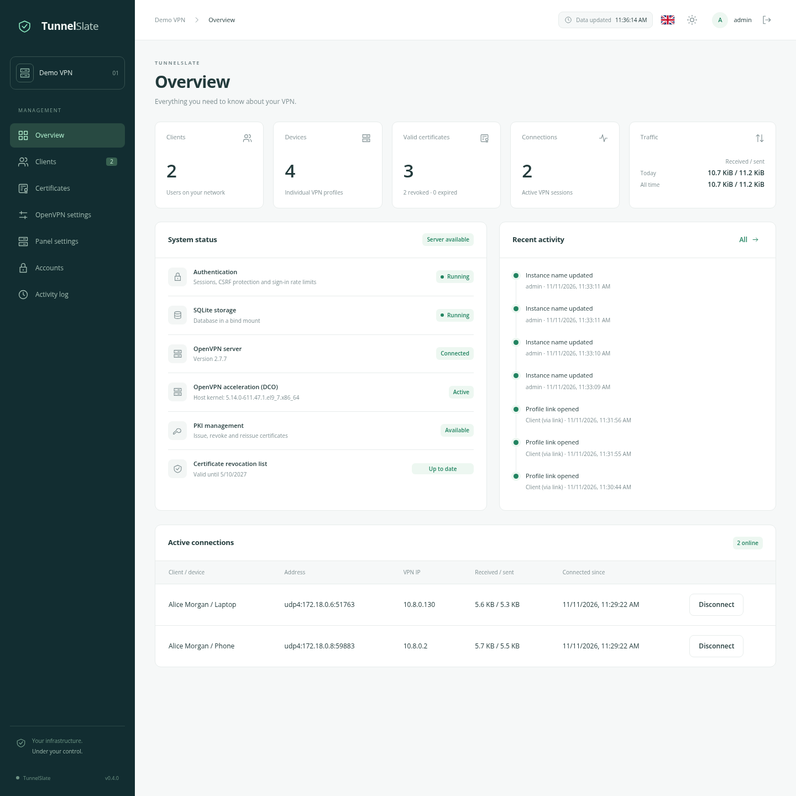
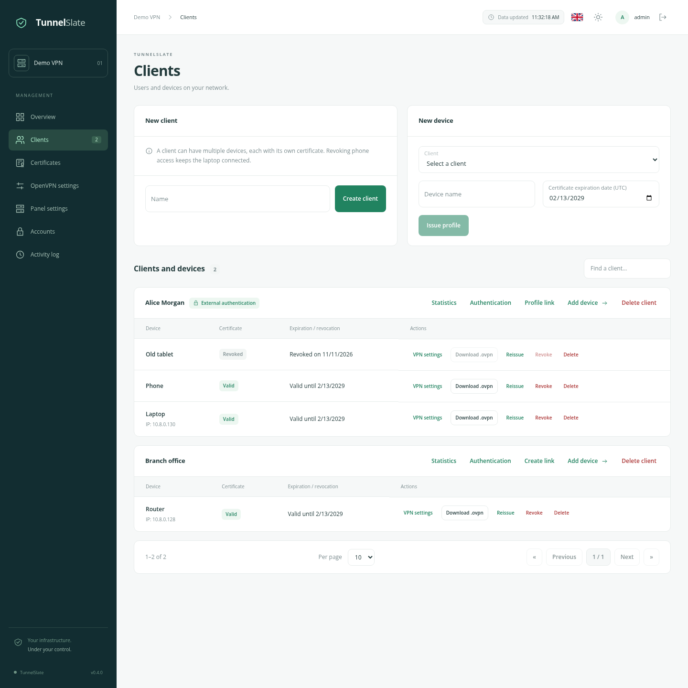
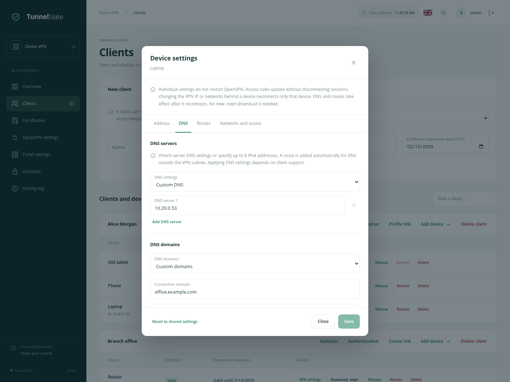
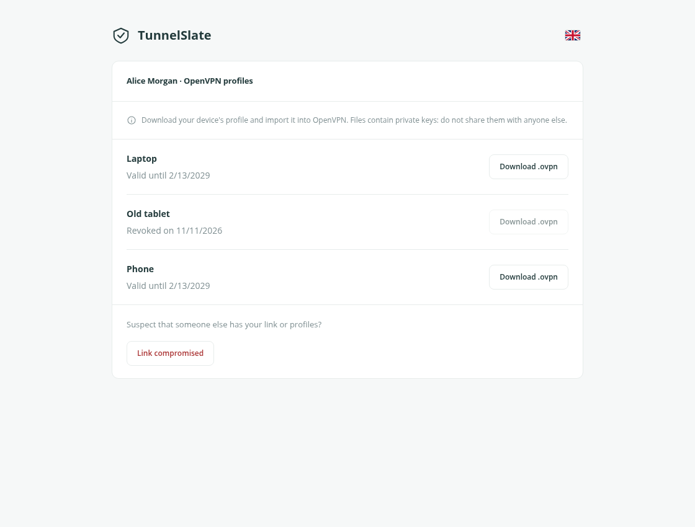

# TunnelSlate

**Version 0.4.0** · [GPL-3.0-or-later](/LICENSE)

**Manage VPN access in a browser.**

English · [Русский](/docs/OVERVIEW_ru.md)

TunnelSlate is a standalone panel for a personal VPN server or a small team. It lets you grant network access, manage devices and certificates, change OpenVPN settings, and see what is happening on the server.

[Quickstart](/docs/QUICKSTART_en.md) · [How it works](/docs/ARCHITECTURE_en.md) · [OpenVPN settings](/docs/OPENVPN_SETTINGS_en.md) · [Changelog](/docs/CHANGELOG_en.md)

## Why this project exists

None of the existing tools quite fit: some lacked features we needed, some had frustrating bugs, and others left us wanting a more convenient interface. So we decided to build our own, around our needs and with behavior we could rely on.

The goal was a straightforward way to manage a private VPN: a clear interface, built-in sign-in, multiple administrators, and predictable certificate operations. Losing a phone should not mean disconnecting every other device. Changing settings should not require assembling profiles by hand. The data should stay in ordinary directories on your own server.

TunnelSlate grew out of those needs. It is an independent application for one server, deployed with Docker Compose, without Kubernetes or an external database.

## Clients and devices

A client can have several devices. Each device has its own certificate, access expiry date, and connection profile. You can revoke a phone while keeping a laptop connected, or give a contractor access until a specific date.

- Create clients and devices, search them, and browse paginated lists.
- Download ready-to-use `.ovpn` files, reissue certificates, and revoke access.
- Delete a device or client together with its access.
- Review certificate history and unfinished operations.

## Settings without editing directives

The panel manages the server address, protocol, VPN subnet, DNS servers, additional networks, and traffic routing: selected networks only, or all IPv4 traffic through the VPN.

A visual CCD editor handles per-device settings. Assign a fixed VPN address, or choose separate DNS servers, DNS domains, and routes. These settings survive certificate reissues. Isolate VPN devices, restrict access to selected networks, or connect a LAN behind a VPN router with site-to-site.

## Share profiles through a link

An administrator can download a profile and send it directly, or create a dedicated link for a client. That page shows only the client's devices and available connection files. It does not require an administrator account.

The link can be replaced or disabled. If it reaches someone else, the “Link compromised” button closes it and starts revoking the client's certificates. An administrator then restores access.

## Also included

- Optional LDAP/RADIUS VPN password verification, retaining device certificates and mixed modes on one server. [Configuration guide](/docs/VPN_AUTH_en.md).
- Multiple administrators, one-time passwords for first sign-in, and session management.
- Two-factor sign-in with TOTP: each administrator can connect an authenticator app.
- Active VPN connections, with an option to disconnect an individual session.
- Lifetime server, client and device statistics, daily history and configurable retention. [Learn more](/docs/STATISTICS_en.md).
- An activity log with configurable retention.
- Automatic renewal of the certificate revocation list, or CRL.
- Live updates without refreshing the page.
- English and Russian, with light and dark themes.
- Hosting on a dedicated domain or under a path such as `/ovpn`.

## Built for your own server

TunnelSlate runs as a separate installation on a Linux host with Docker. The panel and OpenVPN run alongside each other. Persistent data lives in host directories, which can be included in your existing backups.

To get started, copy the project, fill in the settings, and run `docker compose up -d`. Initialize the VPN and manage access in the browser. Follow the [quickstart](/docs/QUICKSTART_en.md) to connect your first device.

## License

Copyright (c) 2026 TunnelSlate contributors.

TunnelSlate is free software: you can redistribute it and/or modify it under the GNU General Public License, version 3 or any later version, as published by the Free Software Foundation. It is distributed without any warranty. See [LICENSE](/LICENSE) for the full terms. Third-party components retain their own licenses.
