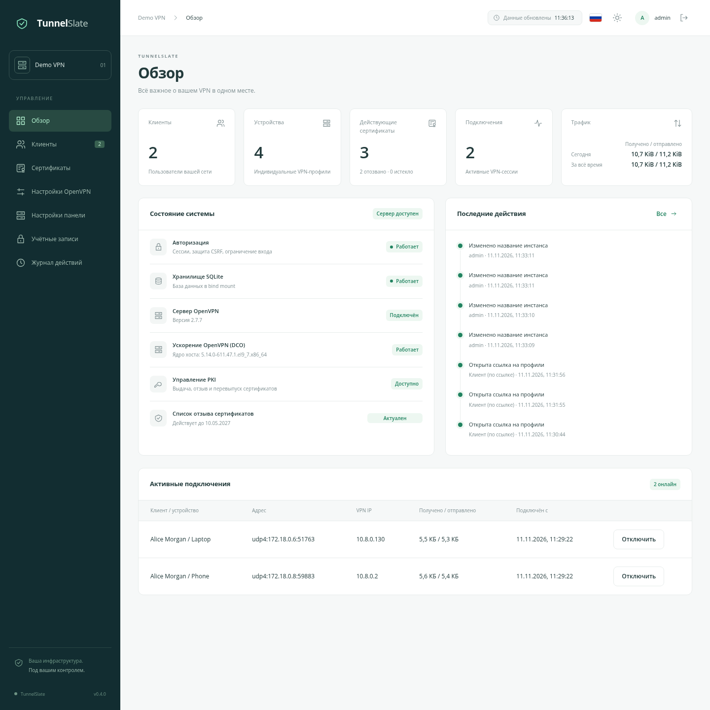
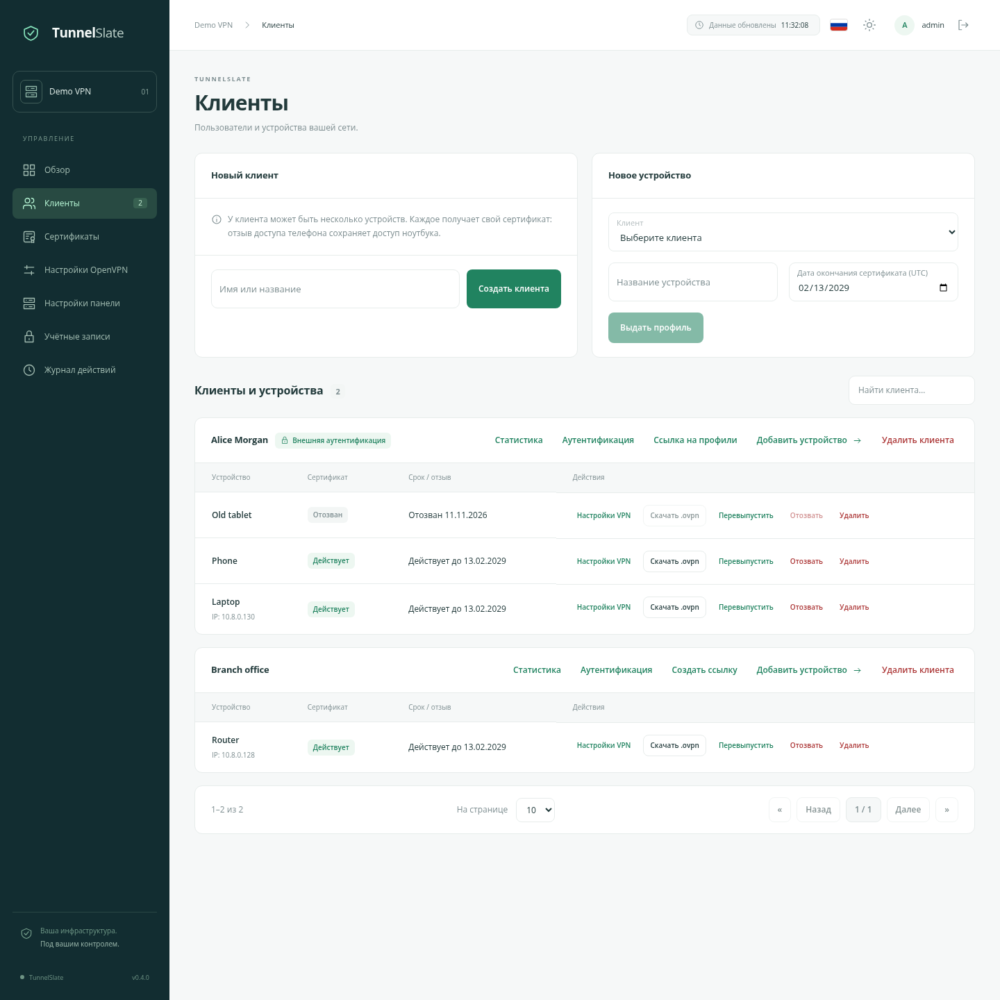
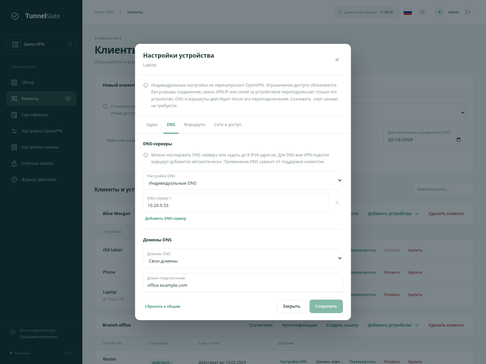
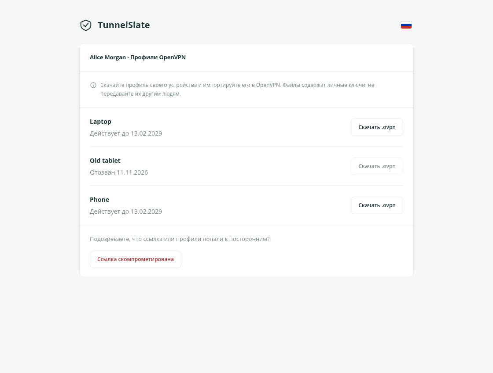

# TunnelSlate

**Версия 0.4.0** · [GPL-3.0-or-later](/LICENSE)

**Управляйте VPN-доступом из браузера.**

Русский · [English](/docs/OVERVIEW_en.md)

TunnelSlate — самостоятельная панель для личного VPN-сервера или небольшой команды. Она помогает выдавать доступ к сети, управлять устройствами и сертификатами, менять настройки OpenVPN и видеть, что происходит на сервере.

[Быстрый старт](/docs/QUICKSTART_ru.md) · [Как устроено](/docs/ARCHITECTURE_ru.md) · [Настройки OpenVPN](/docs/OPENVPN_SETTINGS_ru.md) · [История изменений](/docs/CHANGELOG_ru.md)

## Зачем появился проект

Среди существующих решений не нашлось того, которое подходило бы во всём: где-то не хватало нужных функций, где-то мешали неприятные баги, а где-то хотелось более удобного интерфейса. В итоге решили сделать своё — под собственные задачи и с понятным поведением.

Хотелось управлять своим VPN из понятного интерфейса: с авторизацией, несколькими администраторами и предсказуемой работой с сертификатами. Чтобы отключение потерянного телефона не затрагивало остальные устройства, смена настроек не требовала ручной сборки профилей, а данные оставались в обычных каталогах на своём сервере.

Так появился TunnelSlate. Это отдельное приложение для одного сервера, которое можно развернуть через Docker Compose и обслуживать без Kubernetes и внешней базы данных.

## Клиенты и устройства

У одного клиента может быть несколько устройств. У каждого — свой сертификат, срок доступа и файл подключения. Телефон можно отозвать отдельно от ноутбука, а подрядчику выдать доступ только до нужной даты.

- Создание клиентов и устройств, поиск и списки с пагинацией.
- Скачивание готовых `.ovpn`, перевыпуск и отзыв сертификатов.
- Удаление устройства или клиента с отзывом его доступа.
- История сертификатов и состояние незавершённых операций.

## Настройки без ручной правки директив

В панели задаются адрес сервера, протокол, подсеть VPN, DNS, дополнительные сети и направление трафика: только выбранные сети или весь IPv4-трафик через VPN.

Для отдельных устройств есть визуальный редактор CCD. Он позволяет закрепить VPN-IP и выбрать собственные DNS-серверы, DNS-домены и маршруты. Настройки сохраняются при перевыпуске сертификата. Можно изолировать VPN-устройства, ограничить доступ выбранными сетями или подключить локальную сеть за VPN-роутером через site-to-site.

## Профили можно передать ссылкой

Администратор может скачать профиль и передать его вручную либо создать отдельную ссылку для клиента. По ней видны только устройства этого клиента и доступные файлы подключения. Учётная запись в админке для этого не нужна.

Ссылку можно заменить или закрыть. Если она попала к посторонним, кнопка «Ссылка скомпрометирована» закрывает ссылку и запускает отзыв сертификатов клиента. Восстановлением доступа занимается администратор.

## Что ещё есть

- Необязательная проверка VPN-пароля через LDAP/RADIUS с сохранением сертификатов устройств и смешанных режимов на одном сервере. [Как настроить](/docs/VPN_AUTH_ru.md).
- Несколько администраторов, одноразовые пароли для первого входа и управление сессиями.
- Двухфакторный вход с TOTP: каждый администратор может подключить приложение-аутентификатор.
- Активные VPN-подключения с возможностью отключить отдельную сессию.
- Накопленная статистика сервера, клиентов и устройств, дневная история и настраиваемый срок её хранения. [Подробнее](/docs/STATISTICS_ru.md).
- Журнал действий с настраиваемым сроком хранения.
- Автоматическое продление списка отозванных сертификатов — CRL.
- Обновление данных без ручной перезагрузки страницы.
- Русский и английский языки, светлая и тёмная темы.
- Размещение на своём домене или по пути вроде `/ovpn`.

## Настройки панели и мониторинг

В **Настройках панели** можно задать название инстанса и включить сбор метрик через Prometheus. Готовый dashboard Grafana показывает состояние VPN, трафик и сроки сертификатов. При необходимости доступ к метрикам защищается клиентскими сертификатами (mTLS). [Настройка мониторинга и оповещений](/docs/MONITORING_ru.md).

## Для своего сервера

TunnelSlate предназначен для отдельной установки на Linux-хосте с Docker. Панель и OpenVPN работают рядом, а постоянные данные подключаются из каталогов хоста. Их можно включить в уже существующее резервное копирование.

Для начала достаточно скопировать проект, заполнить настройки и выполнить `docker compose up -d`. Создание VPN и дальнейшая работа с доступами происходят в браузере. Шаги до первого подключения — в [быстром старте](/docs/QUICKSTART_ru.md).

## Лицензия

Copyright (c) 2026 TunnelSlate contributors.

TunnelSlate — свободное программное обеспечение: его можно распространять и изменять на условиях GNU General Public License версии 3 или любой более поздней версии, опубликованной Free Software Foundation. Программа распространяется без каких-либо гарантий. Полные условия — в [LICENSE](/LICENSE). Сторонние компоненты сохраняют собственные лицензии.
