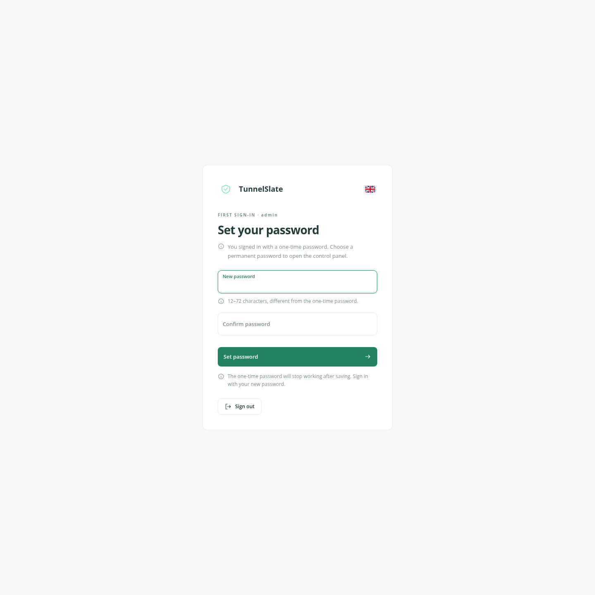
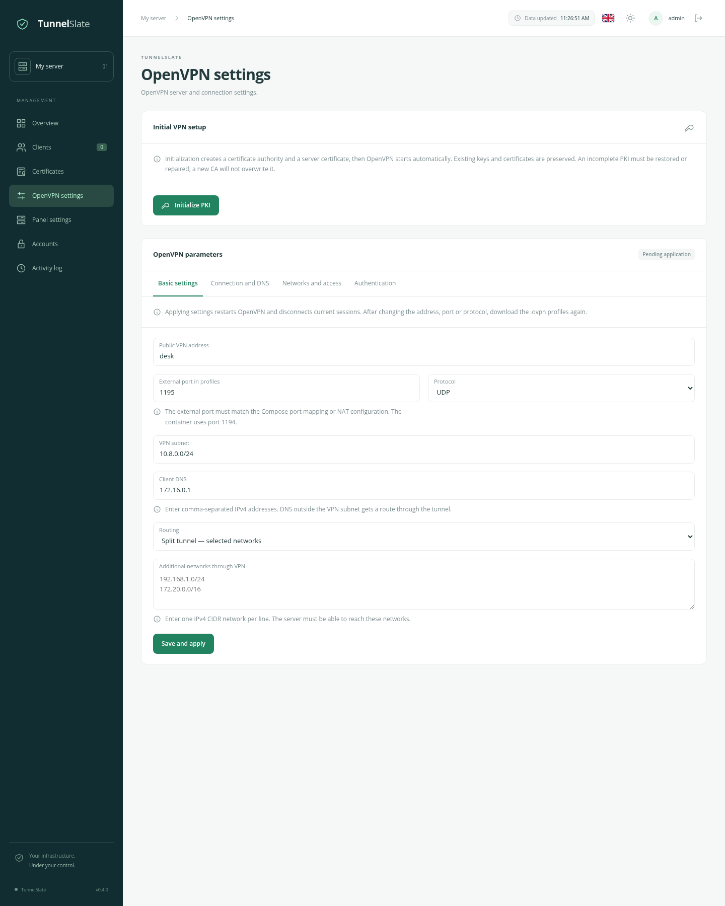

# TunnelSlate quickstart

English · [Русский](/docs/QUICKSTART_ru.md) · [Overview](/docs/OVERVIEW_en.md) · [Administration](/docs/ADMINISTRATION_en.md)

You need a Linux server with Docker Engine, Docker Compose, internet access and `/dev/net/tun`. For HTTPS access, prepare a domain, a certificate and nginx on the same server.

## 1. Get the project

```sh
git clone https://github.com/flanteq/tunnelslate.git
cd tunnelslate
cp .env.example .env
cp docker-compose.example.yml docker-compose.yml
```

If using a source archive, extract it and run the two `cp` commands in the project directory.

## 2. Configure the installation

Set the panel address in `.env`:

```dotenv
TUNNELSLATE_PUBLIC_URL=https://tunnelslate.example.com
TUNNELSLATE_BASE_PATH=
TUNNELSLATE_COOKIE_SECURE=true
```

Replace the domain with yours. Leave the other settings at their defaults for now. No username or password configuration is needed.

Check these settings in `docker-compose.yml`:

- **Data:** stored in `./data`. To use another location, change only the host paths on the left in `volumes`.
- **Panel:** `127.0.0.1:8090`, accessed through nginx.
- **VPN:** external port `1195` for UDP and TCP. To change it, replace `1195` in both entries; keep internal port `1194`. Open the selected port in your firewall and forward it through your router if necessary.

## 3. Start the panel

```sh
docker compose up -d
docker compose ps
```

The first build takes a few minutes. View logs with `docker compose logs -f --tail=100`. OpenVPN starts after configuration in the panel.

Configure nginx using the [dedicated domain example](/deploy/nginx.conf.example): replace the domain and certificate paths, keeping `proxy_pass http://127.0.0.1:8090`. Check the configuration with `nginx -t` and reload nginx.

Set `TUNNELSLATE_TRUSTED_PROXIES` in `.env` for correct client IPs and sign-in protection. With host nginx, this is usually the Docker gateway:

```sh
docker inspect tunnelslate --format '{{range .NetworkSettings.Networks}}{{.Gateway}}{{end}}'
```

Copy the returned address into `TUNNELSLATE_TRUSTED_PROXIES` and run `docker compose up -d` again.

For hosting under `/ovpn/` or a local check without nginx, see [panel access](/docs/ADMINISTRATION_en.md#panel-access).

## 4. Sign in

Retrieve the one-time password:

```sh
docker compose exec tunnelslate cat /data/app/initial_admin_password
```

Open the address from `.env` and sign in as **admin** with this password. Set a permanent password of 12–72 characters and sign in again. Saving removes the initial password file and invalidates the one-time password.

If password setup is not completed, the one-time password remains valid.



## 5. Configure the VPN and connect a device

In **OpenVPN settings**, enter:

- The public VPN IP or hostname without `https://` and external port — `1195` if using the Compose example unchanged.
- UDP or TCP.
- A VPN subnet that does not overlap the Docker network or your devices' local networks.
- DNS servers reachable by devices and the required routing mode.

Save the settings and click **Initialize PKI**. OpenVPN starts automatically.



In **Clients**, create a client, add a device and download its `.ovpn` file. Import it into an OpenVPN client and connect. The profile contains a private key; share it only with its owner.

## Next steps

- [Administration](/docs/ADMINISTRATION_en.md): `.env` reference, TOTP, access recovery, updates, backups and DCO installation.
- [OpenVPN settings](/docs/OPENVPN_SETTINGS_en.md): DNS, routing, MTU/MSS, isolation and site-to-site.
- [LDAP and RADIUS](/docs/VPN_AUTH_en.md), [statistics](/docs/STATISTICS_en.md), [Prometheus and Grafana](/docs/MONITORING_en.md).
