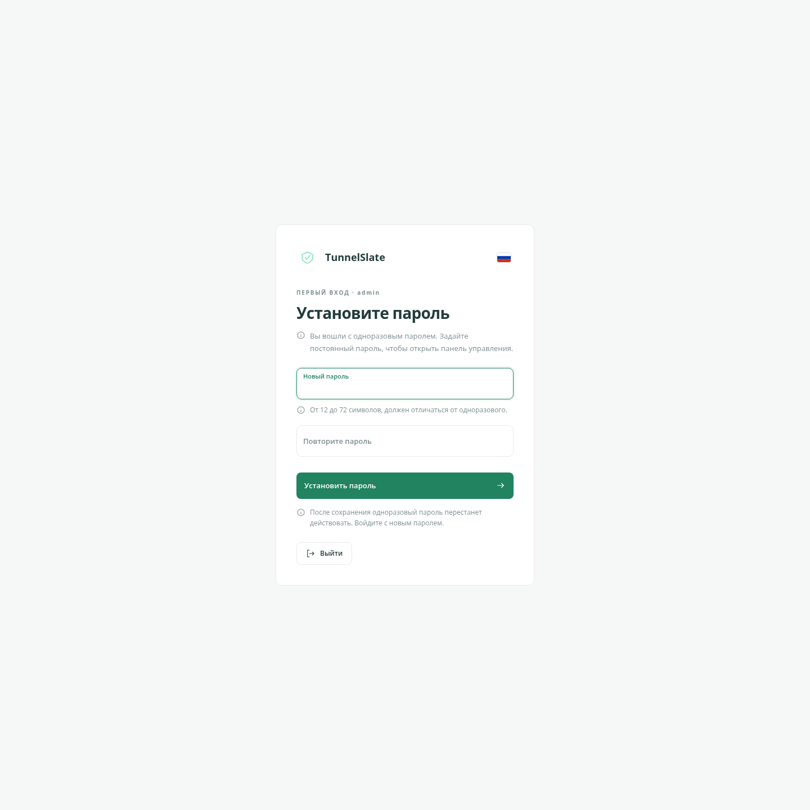
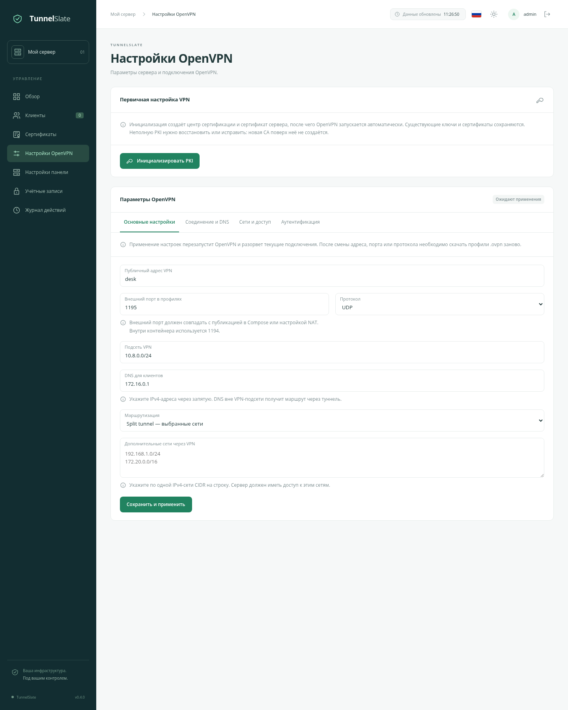

# Быстрый старт TunnelSlate

Русский · [English](/docs/QUICKSTART_en.md) · [О проекте](/docs/OVERVIEW_ru.md) · [Администрирование](/docs/ADMINISTRATION_ru.md)

Понадобится Linux-сервер с Docker Engine, Docker Compose, доступом в интернет и `/dev/net/tun`. Для доступа через HTTPS подготовьте домен, сертификат и nginx на этом же сервере.

## 1. Скопируйте проект

```sh
git clone https://github.com/flanteq/tunnelslate.git
cd tunnelslate
cp .env.example .env
cp docker-compose.example.yml docker-compose.yml
```

Если используете архив исходников, распакуйте его и выполните две команды `cp` в каталоге проекта.

## 2. Заполните настройки

В `.env` укажите адрес панели:

```dotenv
TUNNELSLATE_PUBLIC_URL=https://tunnelslate.example.com
TUNNELSLATE_BASE_PATH=
TUNNELSLATE_COOKIE_SECURE=true
```

Замените домен своим. Остальные параметры пока можно оставить по умолчанию. Логин и пароль задавать не нужно.

В `docker-compose.yml` проверьте:

- **Данные:** сохраняются в `./data`. Для другого расположения замените только пути слева в `volumes`.
- **Панель:** `127.0.0.1:8090`, доступ через nginx.
- **VPN:** внешний порт `1195` для UDP и TCP. При смене порта замените `1195` в обеих строках, внутренний `1194` оставьте. Откройте выбранный порт в firewall; при наличии роутера настройте проброс.

## 3. Запустите панель

```sh
docker compose up -d
docker compose ps
```

Первая сборка займёт несколько минут. Логи: `docker compose logs -f --tail=100`. OpenVPN начнёт работать после настройки в панели.

Настройте nginx по [примеру для отдельного домена](/deploy/nginx.conf.example): замените домен и пути к сертификату, оставьте `proxy_pass http://127.0.0.1:8090`. Проверьте конфигурацию командой `nginx -t` и перезагрузите nginx.

Для корректных IP-адресов и защиты входа задайте в `.env` параметр `TUNNELSLATE_TRUSTED_PROXIES`. При nginx на хосте это обычно Docker-шлюз:

```sh
docker inspect tunnelslate --format '{{range .NetworkSettings.Networks}}{{.Gateway}}{{end}}'
```

Скопируйте полученный адрес в `TUNNELSLATE_TRUSTED_PROXIES` и повторите `docker compose up -d`.

Размещение по пути `/ovpn/` и локальный запуск без nginx описаны в [руководстве по администрированию](/docs/ADMINISTRATION_ru.md#доступ-к-панели).

## 4. Войдите в панель

Получите одноразовый пароль:

```sh
docker compose exec tunnelslate cat /data/app/initial_admin_password
```

Откройте адрес из `.env` и войдите как **admin** с этим паролем. Установите постоянный пароль длиной 12–72 символа и войдите снова. После сохранения файл удалится, одноразовый пароль перестанет работать.

Если не завершить установку пароля, одноразовый продолжит действовать.



## 5. Настройте VPN и подключите устройство

В **«Настройках OpenVPN»** укажите:

- Публичный IP или доменное имя VPN-сервера без `https://` и внешний порт — `1195`, если оставили пример Compose.
- Протокол UDP или TCP.
- Подсеть VPN, которая не пересекается с Docker-сетью и локальными сетями устройств.
- Доступные устройствам DNS-серверы и нужный режим маршрутизации.

Сохраните настройки и нажмите **«Инициализировать PKI»**. OpenVPN запустится автоматически.



В **«Клиентах»** создайте клиента, добавьте устройство и скачайте `.ovpn`. Импортируйте файл в OpenVPN-клиент и подключитесь. Профиль содержит личный ключ — передавайте его только владельцу.

## Дальше

- [Администрирование](/docs/ADMINISTRATION_ru.md): параметры `.env`, TOTP, восстановление доступа, обновления, резервные копии и установка DCO.
- [Настройки OpenVPN](/docs/OPENVPN_SETTINGS_ru.md): DNS, маршруты, MTU/MSS, изоляция и site-to-site.
- [LDAP и RADIUS](/docs/VPN_AUTH_ru.md), [статистика](/docs/STATISTICS_ru.md), [Prometheus и Grafana](/docs/MONITORING_ru.md).
