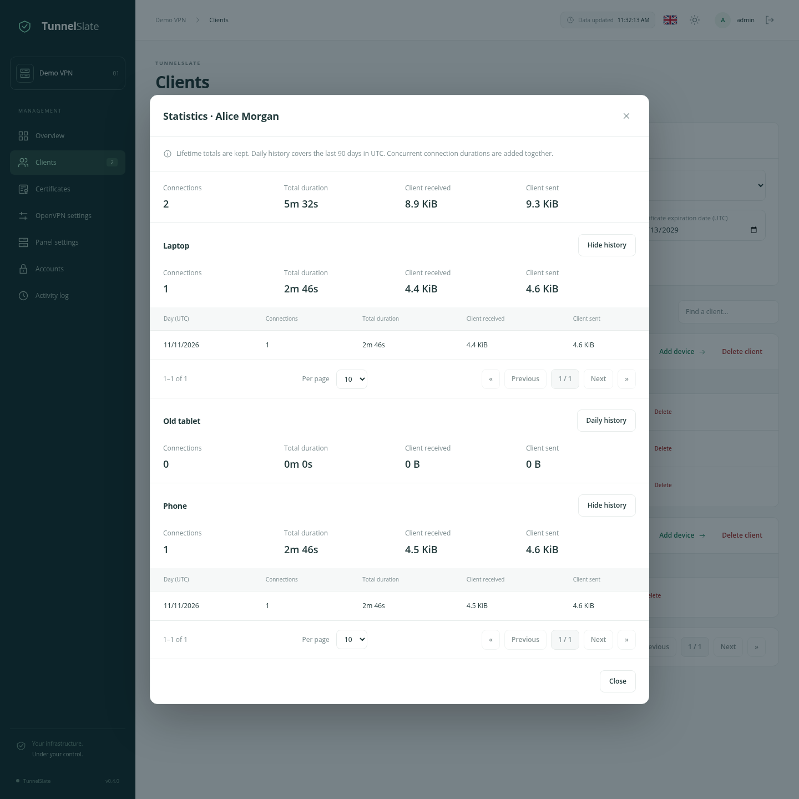

# VPN statistics

English · [Русский](/docs/STATISTICS_ru.md) · [About the project](/docs/OVERVIEW_en.md) · [Quickstart](/docs/QUICKSTART_en.md)

## Where to find them

The **Traffic** card in the top row of Overview has two rows: **Today** and **All time**. The Received / sent caption above the values on the right explains their order: client received bytes followed by `/` and client sent bytes. Today starts at midnight UTC and updates automatically when the day changes. The server-wide daily counter is stored independently and keeps the traffic of deleted clients and devices.

On Clients, click **Statistics** beside a client name. The top of the dialog shows the client's lifetime totals, followed by totals for each device. **Daily history** expands a device's daily table with independent pagination. Individual sessions remain in the database; the interface groups them by day.

## What the numbers mean

- **Connections** counts started VPN sessions. Reconnecting starts a new session.
- **Total duration** adds the time of all connections, including current ones. Concurrent connections add up: two devices connected for one hour contribute two hours.
- **Client received / Client sent** are OpenVPN counters viewed from the device. They are not per-application counters or ISP billing measurements. Sizes use binary units: KiB, MiB and GiB.

Daily tables use **UTC**. A session spanning midnight contributes duration and traffic to both days. The connection count increases only on its starting day. Duration is split exactly at midnight; traffic between adjacent samples is apportioned by elapsed time. Traffic allocation between the two days is therefore approximate at midnight, while the overall byte count is preserved.

## Retention and deletion

`TUNNELSLATE_STATS_RETENTION_DAYS` in `.env` controls detailed history retention. The default is **90 days**. After changing it, restart the panel container to load the new value. Cleanup runs at startup and once a day.

Old completed sessions and device/server daily entries are removed; active sessions are kept. Lifetime totals are stored separately and are unaffected by retention.

Deleting a device removes its statistics, but previously counted usage remains in the client and server totals. Deleting a client removes its statistics and device history; server totals remain. A lifetime total may therefore exceed the sum of remaining devices or clients. Reissuing a certificate preserves device statistics.

Collection starts when a version supporting statistics is installed. Earlier connections are not reconstructed from the activity log.

## Updates and restarts

The OpenVPN container saves counters approximately every five seconds and records final counters when a session ends. The panel transfers them into the database and notifies the open interface. Displayed values may lag by a few seconds.

Collection continues while the panel is stopped. Pending data waits in `control/statistics` inside the persistent data directory. Back up the entire data directory, including both the database and `control`, to preserve pending records.

After an OpenVPN or host crash, a session closes at its last saved sample and is marked interrupted in the database. The most recent unsaved seconds and bytes may be lost. Reprocessing saved data does not increase totals. If a device disappears without disconnecting cleanly, OpenVPN considers the session active until its timeout.

Collection works with and without DCO. It uses OpenVPN's own counters and requires no additional container.

On upgrade, daily server totals are restored from retained session data. Traffic from history that has already been deleted cannot be fully reconstructed; new usage is counted independently of client or device deletion.
