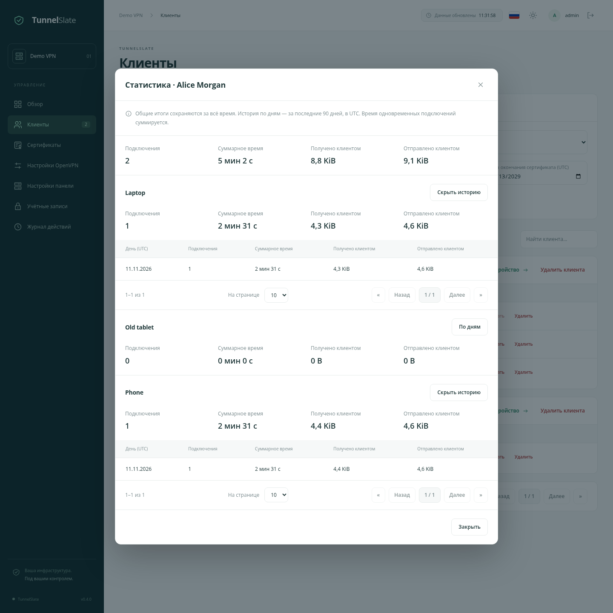

# Статистика VPN

Русский · [English](/docs/STATISTICS_en.md) · [О проекте](/docs/OVERVIEW_ru.md) · [Быстрый старт](/docs/QUICKSTART_ru.md)

## Где смотреть

В верхнем ряду «Обзора» карточка «Трафик» показывает две строки: «Сегодня» и «За всё время». Подпись «Получено / отправлено» над значениями справа поясняет порядок: сначала полученный клиентами объём, затем через `/` — отправленный. «Сегодня» считается с полуночи UTC; при переходе суток строка обновляется автоматически. Суточный счётчик сервера хранится отдельно и сохраняет трафик удалённых клиентов и устройств.

На странице «Клиенты» нажмите «Статистика» рядом с именем клиента. Вверху окна — общие итоги клиента, ниже — итоги каждого устройства. Кнопка «По дням» раскрывает историю устройства с отдельной пагинацией. Отдельные сессии сохраняются в БД; в интерфейсе они объединены по дням.

## Что означают показатели

- **Подключения** — количество начавшихся VPN-сессий. Переподключение считается новой сессией.
- **Суммарное время** — время всех подключений, включая текущие. Одновременные подключения суммируются: два устройства, подключённые на час, дадут два часа.
- **Получено клиентом / Отправлено клиентом** — счётчики OpenVPN с точки зрения устройства. Это не счётчики отдельных приложений и не данные для расчёта тарифа провайдера. Объёмы показаны в двоичных единицах: KiB, MiB, GiB.

Все дневные таблицы используют **UTC**. Если сессия началась до полуночи и продолжилась после неё, время и трафик попадут в оба дня. Количество подключений увеличится только в день начала сессии. Время делится по границе суток точно; трафик между соседними замерами распределяется пропорционально времени. Поэтому его распределение между двумя днями на границе суток приблизительное, а общий объём сохраняется.

## Хранение и удаление

`TUNNELSLATE_STATS_RETENTION_DAYS` в `.env` задаёт срок хранения подробной истории. По умолчанию — **90 дней**. После изменения перезапустите контейнер панели, чтобы он прочитал новое значение. Проверка выполняется при запуске и раз в сутки.

Старые завершённые сессии и дневные записи устройств и сервера удаляются; текущие сессии сохраняются. Накопленные итоги хранятся отдельно и по retention не очищаются.

При удалении устройства удаляется его статистика, но ранее учтённые данные остаются в итогах клиента и сервера. При удалении клиента удаляется его статистика и история устройств; итоги сервера сохраняются. Поэтому общий итог может быть больше суммы оставшихся устройств или клиентов. Перевыпуск сертификата не обнуляет статистику устройства.

Статистика начинается с установки версии, в которой появился сбор. Прошлые подключения по журналу действий не восстанавливаются.

## Обновление и перезапуски

Контейнер OpenVPN сохраняет счётчики примерно каждые пять секунд, а при завершении сессии — её итог. Панель переносит их в БД и сообщает об изменениях открытому интерфейсу. Обновление на экране может отставать на несколько секунд.

Остановка панели не останавливает сбор: данные ждут её запуска в общем каталоге `control/statistics` внутри каталога постоянных данных. При резервном копировании сохраняйте весь каталог данных вместе с БД и `control`, чтобы не потерять ещё не обработанную очередь.

При аварийной остановке OpenVPN или хоста сессия закрывается по последнему сохранённому замеру и помечается в БД как прерванная. Последние несохранённые секунды и байты могут быть потеряны. Повторная обработка уже сохранённых данных не увеличивает итоги. Если устройство исчезло без корректного отключения, OpenVPN считает сессию действующей до своего таймаута.

Сбор работает с DCO и без него. Он использует счётчики самого OpenVPN и не требует отдельного контейнера.

При обновлении суточные итоги сервера восстанавливаются из сохранившихся данных сессий. Трафик из уже удалённой истории полностью восстановить нельзя; новые данные учитываются независимо от удаления клиентов и устройств.
