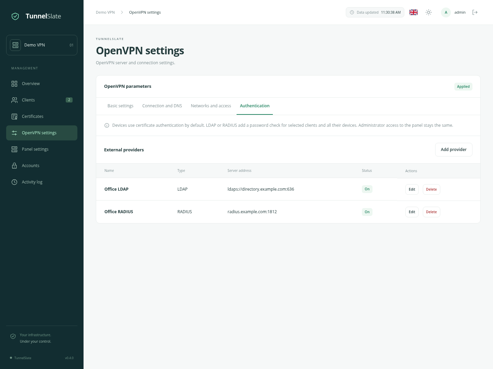
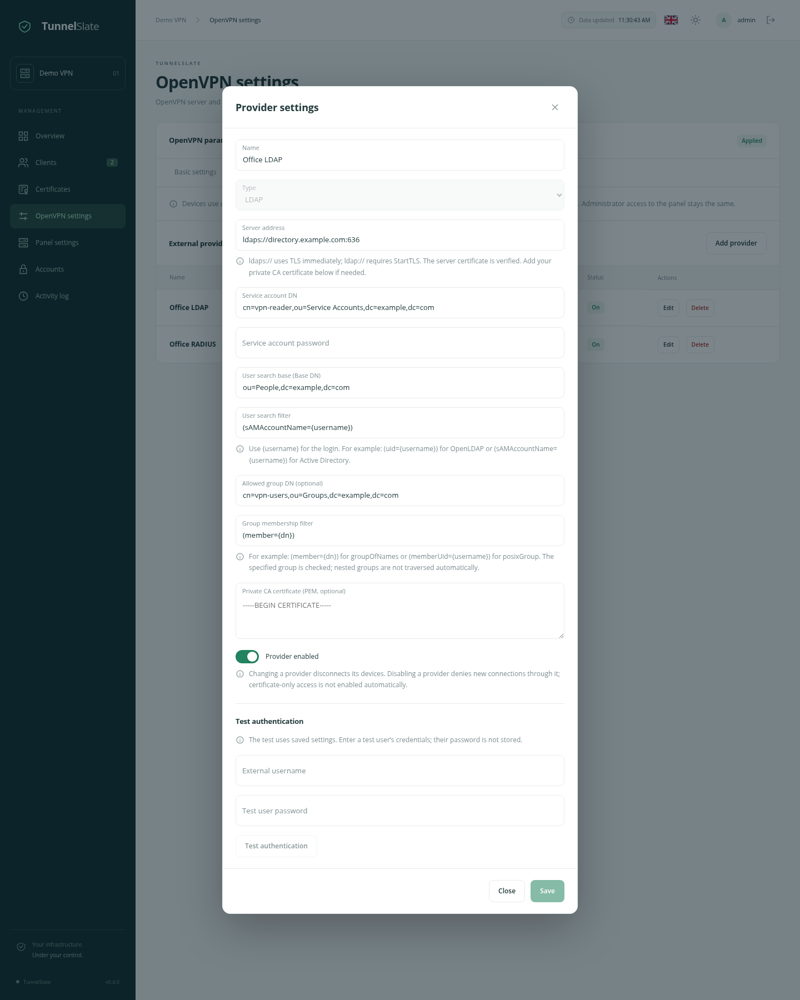
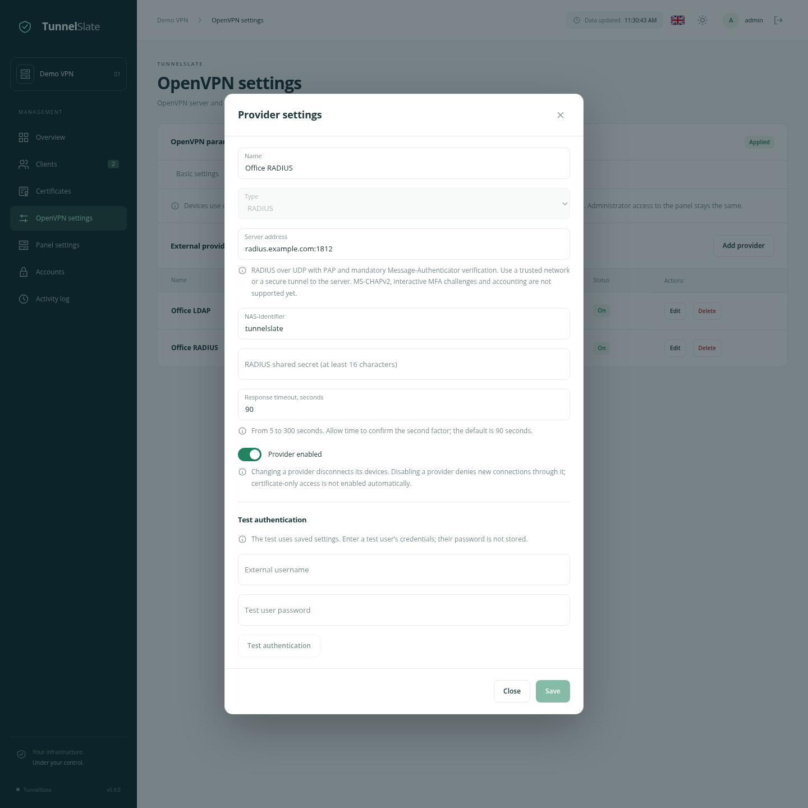

# LDAP and RADIUS for VPN connections

English · [Русский](/docs/VPN_AUTH_ru.md) · [OpenVPN settings](/docs/OPENVPN_SETTINGS_en.md) · [Quickstart](/docs/QUICKSTART_en.md)

Devices connect using their individual certificate from the `.ovpn` profile by default. You can add an external username and password check through LDAP or RADIUS. These modes work together on the same VPN server and port.

A client certificate remains required. External providers do not create panel administrators or grant access to the admin interface.

## Getting started

1. Open **OpenVPN settings → Authentication** and add a provider.
2. Save its settings. Test authentication with a test user in the same dialog.
3. In **Clients**, click **Authentication** in the relevant client’s header.
4. Select **Certificate and external password**, a provider and that client’s external username.
5. Download fresh `.ovpn` files and replace the imported profiles. The VPN application will request the external username and password when connecting.

Providers and connection methods have separate save buttons in their dialogs. The **Save and apply** button on the other tabs saves VPN settings, not these dialogs.

## Clients and devices

| Mode | What is checked |
| --- | --- |
| Certificate only | The device certificate’s authenticity, expiry and revocation. This is the default. |
| Certificate and external password | The device certificate and the specified external account’s password through the selected provider. |

Authentication is configured only for the **client** and applies to all its devices, including devices added later. All profiles use the same provider and external username; individual device overrides are unavailable. Create separate clients when different authentication methods are needed.

An **External authentication** badge beside the client name indicates the extra check. If its provider is disabled, the badge shows **Provider disabled** as a warning; access does not fall back to certificate-only authentication.

The external username is explicitly assigned. A valid password for a different user cannot be combined with this client’s certificate. The username must match the spelling and case configured in the panel. Latin letters, digits and `_`, `.`, `@`, `-` are supported. For Active Directory, use a UPN or `sAMAccountName` with an appropriate search filter.

CCD, fixed VPN addresses, network restrictions and site-to-site remain bound to the device. Certificate reissues preserve its authentication policy. A revoked or expired certificate does not work even with the correct external password. Reporting a profile link as compromised still revokes that client’s certificates.

Changing the connection method disconnects the affected devices’ previous VPN sessions, normally within a few seconds. New connections for those devices are temporarily denied until disconnection is confirmed. If OpenVPN is unavailable, the operation is retried when it returns. External accounts are not modified.

## LDAP

The LDAP provider searches for exactly one user, optionally checks group membership, and verifies the password by binding as the matched user.

| Field | What to enter |
| --- | --- |
| Server address | `ldaps://directory.example.com:636` or `ldap://directory.example.com:389`. The first uses TLS immediately; the second requires StartTLS before sending any passwords. |
| Service account DN | An account allowed to search users and read the required group, for example `cn=vpn-reader,dc=example,dc=com`. Directory administrator privileges are unnecessary. |
| Service account password | The password of that account. Leave it empty when editing to keep the existing value. |
| User search base | The search scope, for example `ou=people,dc=example,dc=com`. |
| User search filter | Usually `(uid={username})` for OpenLDAP, or `(sAMAccountName={username})` / `(userPrincipalName={username})` for AD. It must match exactly one user. |
| Allowed group DN | Optional restriction, for example `cn=vpn-users,ou=groups,dc=example,dc=com`. Leave empty to skip group membership checks. |
| Group membership filter | `(member={dn})` for `groupOfNames`, or `(memberUid={username})` for `posixGroup`. `{dn}` is the matched user’s DN and `{username}` is the submitted login. Only the specified group is checked; nested groups are not traversed automatically. |
| Private CA certificate | A PEM CA certificate if the server uses a corporate CA. Publicly trusted CAs are already supported. The hostname in the server address must match its certificate. |

Filter substitutions are escaped before use. Ambiguous searches, incorrect passwords, missing group membership and TLS errors deny access. Unencrypted binds and an option to skip certificate verification are not provided.

How disabled accounts are handled depends on directory policy and the configured filter. For AD, the search filter can also restrict account status. There is no general directory or group synchronisation into the panel.

## RADIUS

The supported method is **RADIUS over UDP using PAP**. The server must return **Access-Accept** or **Access-Reject** and sign replies with **Message-Authenticator**. Missing, duplicate or incorrect signatures are rejected; the regular Response Authenticator is also checked.

| Field | What to enter |
| --- | --- |
| Server address | A hostname or IP with a port, for example `radius.example.com:1812`. |
| Shared secret | The same secret in the panel and in the RADIUS client configuration. At least 16 characters; use a long random value. |
| NAS-Identifier | An identifier for this installation in RADIUS policies, for example `tunnelslate`. |
| Response timeout | From 5 to 300 seconds; defaults to 90. The wait for a RADIUS result includes second-factor confirmation. |

Requests originate from the **panel container**, not the OpenVPN process. Authorise the source address actually seen by the RADIUS server after Docker NAT and any intermediate networks. The VPN client’s IP is sent as `Calling-Station-Id`.

Message-Authenticator protects message integrity, but does not turn RADIUS/UDP into TLS. Use a trusted network or a secure tunnel between the panel and RADIUS. RadSec is not supported by this implementation.

MS-CHAPv2, interactive **Access-Challenge**, RADIUS accounting and applying RADIUS-supplied IP addresses/routes are not implemented. The panel retains control of network configuration. For example, Microsoft NPS requires a compatible PAP policy; a policy allowing only MS-CHAPv2 will not work.

For push-based MFA, allow enough time for the user to confirm. The same timeout applies to the panel test and VPN authentication. A single request is sent: waiting does not generate repeated push notifications. Access is denied when the timeout expires.

The RADIUS timeout defaults to 90 seconds. Changing this timeout does not require downloading new profiles.

For nginx, set `proxy_read_timeout 360s;` in the regular panel location so a long MFA test can complete. Both example configurations already include this setting; the separate SSE location retains its existing settings.

## When a provider is unavailable

New logins requiring that provider are denied. There is no automatic fallback to certificate-only access or a different provider.

**Certificate only** devices use the published local policy and can connect even when the panel is stopped. LDAP/RADIUS require the panel during initial and repeat authentication. Existing tunnels continue until their next check or disconnection.

The external password is checked on connection and OpenVPN reauthentication, normally about once an hour. The panel does not receive immediate notifications when a directory account is disabled. Revoke the device’s certificates in the panel to deny access immediately. Disconnecting a session without disabling the account or revoking its certificate still allows it to reconnect.

**Disabling a provider in the panel** disconnects its active sessions and denies new connections. A provider can be deleted after removing its client assignments.

## Passwords, audit and attempt limits

VPN users’ passwords are not stored in the panel database, `.ovpn` profiles or audit log. During verification they pass through a temporary file in the VPN container’s memory and a private local socket. The user’s VPN application may save passwords according to its own settings.

The LDAP service password and RADIUS shared secret are encrypted in the database. The key is stored at `data/app/vpn-auth.key`; back it up and restore it together with the database. A lost key is not automatically replaced while encrypted secrets remain in the database. Saved secrets cannot be read back through the interface.

External verification attempts are limited per IP and device: after five failures, further attempts are temporarily rejected until the 15-minute window ends. A separate request rate limit also applies. These limits are held in memory and reset when the panel restarts; administrator sign-in limits are separate.

Successful external checks and rejections are audited, with rejections marked WARNING. Provider and authentication policy changes are also recorded. Passwords and external server response text are not included in the audit log.

## Updating an existing installation

Update **both** the panel and VPN images with the usual `docker compose up -d` command from the project directory. Compose and `.env` need no changes. New database tables are created automatically; existing clients keep certificate-only access.

For devices where you enable an external password, download and import a fresh `.ovpn` profile. An old profile without `auth-user-pass` does not prompt for credentials and is rejected by the server. A valid certificate alone cannot bypass enabled external authentication; it does not need to be reissued. Passwords are not included in profiles. External password verification does not disable DCO.
