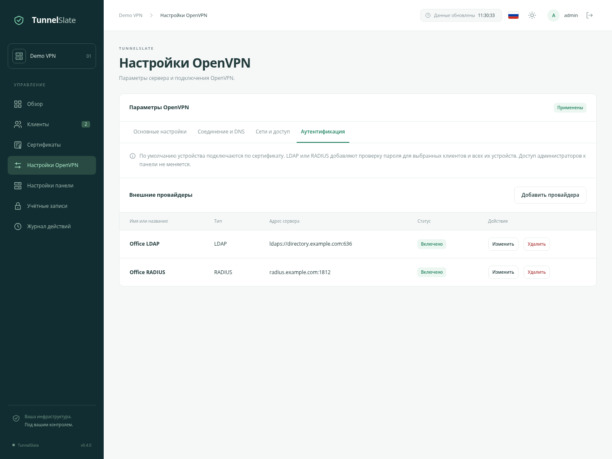
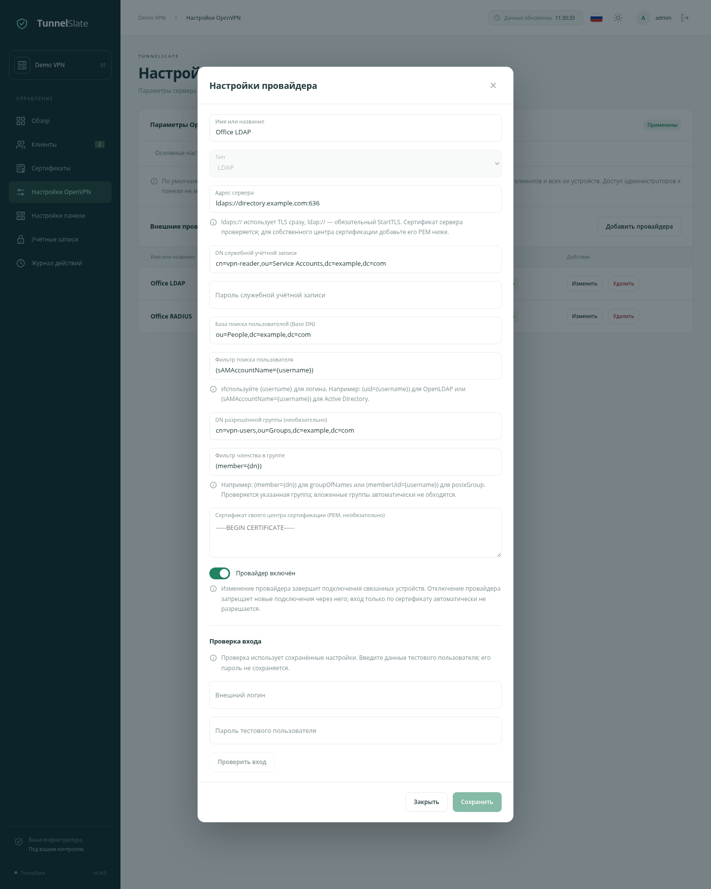
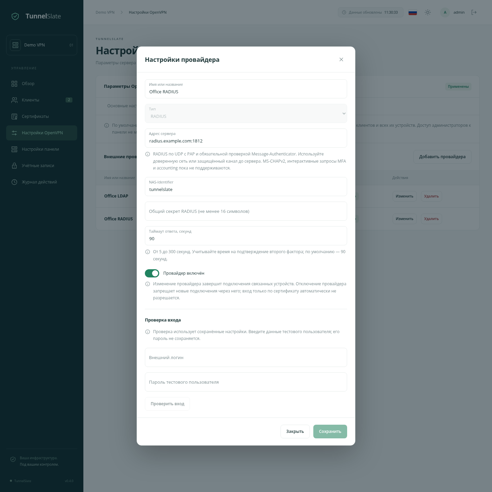

# LDAP и RADIUS для подключения к VPN

Русский · [English](/docs/VPN_AUTH_en.md) · [Настройки OpenVPN](/docs/OPENVPN_SETTINGS_ru.md) · [Быстрый старт](/docs/QUICKSTART_ru.md)

По умолчанию устройство подключается по индивидуальному сертификату из своего `.ovpn`. Можно добавить проверку внешнего логина и пароля через LDAP или RADIUS. Эти режимы работают одновременно на одном VPN-сервере и порту.

Сертификат остаётся обязательным. Внешние провайдеры не создают администраторов панели и не дают доступ в админку.

## Порядок настройки

1. Откройте **Настройки OpenVPN → Аутентификация** и добавьте провайдера.
2. Сохраните его настройки. В том же окне проверьте вход с данными тестового пользователя.
3. В разделе **Клиенты** нажмите **Аутентификация** в шапке нужного клиента.
4. Выберите **Сертификат и внешний пароль**, провайдера и внешний логин этого клиента.
5. Скачайте свежие `.ovpn` и замените импортированные профили. При подключении VPN-приложение попросит внешний логин и пароль.

Провайдеры и способы подключения сохраняются отдельными кнопками в своих окнах. Общая кнопка **Сохранить и применить** на других вкладках относится к настройкам VPN, а не к этим окнам.

## Клиенты и устройства

| Режим | Что проверяется |
| --- | --- |
| Только сертификат | Подлинность, срок действия и отзыв сертификата устройства. Это начальный режим. |
| Сертификат и внешний пароль | Сертификат устройства и пароль заданной внешней учётной записи через выбранного провайдера. |

Способ аутентификации задаётся только **клиенту** и применяется ко всем его устройствам, включая созданные позже. Для всех профилей используются один провайдер и один внешний логин; переопределить их у отдельного устройства нельзя. Если устройствам нужны разные способы входа, создайте для них отдельных клиентов.

В шапке клиента бейдж **Внешняя аутентификация** показывает наличие дополнительной проверки. Если назначенный провайдер отключён, бейдж меняется на предупреждение **Провайдер отключён**; подключение только по сертификату автоматически не разрешается.

Внешний логин задаётся явно. Действующий пароль другого пользователя не подходит к сертификату этого клиента. Логин сравнивается с введённым в панели с учётом регистра; используйте одинаковое написание. Поддерживаются латинские буквы, цифры и знаки `_`, `.`, `@`, `-`; для Active Directory удобно использовать UPN либо `sAMAccountName` с подходящим фильтром.

CCD, постоянные VPN-IP, сетевые ограничения и site-to-site по-прежнему привязаны к устройству. Перевыпуск сертификата сохраняет способ подключения. Отозванный или истёкший сертификат не работает даже с правильным внешним паролем. Сообщение о компрометации ссылки по-прежнему отзывает сертификаты клиента.

Изменение способа подключения завершает прежние VPN-сессии затронутых устройств. Обычно это занимает несколько секунд. Пока сервер не подтвердит отключение, новые подключения этих устройств временно запрещены. При недоступности OpenVPN завершение будет повторено после его возвращения. Внешние сервисы при этом не изменяются.

## LDAP

LDAP-провайдер ищет единственную подходящую запись, при необходимости проверяет членство в группе и проверяет пользовательский пароль через bind от имени найденного пользователя.

| Поле | Что указать |
| --- | --- |
| Адрес сервера | `ldaps://directory.example.com:636` либо `ldap://directory.example.com:389`. Первый вариант сразу использует TLS, второй обязательно включает StartTLS перед передачей паролей. |
| DN служебной учётной записи | Учётная запись с правом поиска пользователей и чтения нужной группы, например `cn=vpn-reader,dc=example,dc=com`. Права администратора каталога не требуются. |
| Пароль служебной учётной записи | Пароль этой учётной записи. При редактировании оставьте поле пустым, чтобы сохранить прежнее значение. |
| База поиска пользователей | Область поиска: например `ou=people,dc=example,dc=com`. |
| Фильтр поиска пользователя | Для OpenLDAP обычно `(uid={username})`, для AD — `(sAMAccountName={username})` или `(userPrincipalName={username})`. Фильтр должен находить ровно одного пользователя. |
| DN разрешённой группы | Необязательное ограничение: например `cn=vpn-users,ou=groups,dc=example,dc=com`. Если поле пустое, дополнительная проверка группы не выполняется. |
| Фильтр членства в группе | `(member={dn})` для `groupOfNames`, `(memberUid={username})` для `posixGroup`. `{dn}` — DN найденного пользователя, `{username}` — введённый логин. Проверяется сама указанная группа; автоматического обхода вложенных групп нет. |
| Сертификат своего центра сертификации | PEM-сертификат CA, если сервер использует корпоративный центр сертификации. Общедоступные доверенные CA уже поддерживаются. Имя сервера в адресе должно соответствовать его сертификату. |

Подстановки в LDAP-фильтрах экранируются перед отправкой. Неоднозначный поиск, неверный пароль, отсутствие нужной группы или ошибка TLS приводят к отказу. Незащищённого bind и переключателя отключения проверки сертификата нет.

Проверка заблокированных учётных записей зависит от правил каталога и заданного фильтра. Для AD можно дополнительно ограничить поиск подходящим фильтром состояния учётной записи. Универсальной синхронизации пользователей и групп с панелью нет.

## RADIUS

Поддерживается проверка логина и пароля по **RADIUS/UDP с PAP**. Сервер должен возвращать **Access-Accept** или **Access-Reject** и подписывать ответы атрибутом **Message-Authenticator**. Отсутствующие, повторяющиеся или неверные подписи не принимаются; обычный Response Authenticator также проверяется.

| Поле | Что указать |
| --- | --- |
| Адрес сервера | Имя или IP и порт, например `radius.example.com:1812`. |
| Общий секрет | Одинаковый секрет в панели и в настройках клиента на RADIUS-сервере. Не менее 16 символов; используйте длинное случайное значение. |
| NAS-Identifier | Имя этой установки для правил RADIUS, например `tunnelslate`. |
| Таймаут ответа | От 5 до 300 секунд; по умолчанию 90. Это время ожидания результата RADIUS, включая подтверждение второго фактора. |

Запрос отправляет **контейнер панели**, а не процесс OpenVPN. В списке разрешённых RADIUS-клиентов укажите адрес, который RADIUS реально видит после Docker NAT и других промежуточных сетей. В `Calling-Station-Id` передаётся IP VPN-клиента.

Message-Authenticator защищает целостность сообщений, но не превращает RADIUS/UDP в TLS. Между панелью и RADIUS используйте доверенную сеть или защищённый туннель. RadSec в этой реализации не поддерживается.

MS-CHAPv2, интерактивный **Access-Challenge**, RADIUS accounting и применение возвращённых RADIUS адресов/маршрутов не реализованы. Сетевые настройки остаются под управлением панели. Например, для Microsoft NPS нужно отдельно проверить и настроить совместимую политику PAP; конфигурация, допускающая только MS-CHAPv2, не подойдёт.

Для push-подтверждения через MFA задайте время, за которое пользователь успеет ответить. Таймаут одинаково применяется к тесту в панели и подключению VPN. Отправляется один запрос: ожидание не порождает повторные push-уведомления. По истечении срока доступ отклоняется.

По умолчанию таймаут RADIUS — 90 секунд. Изменение этого таймаута не требует повторного скачивания профилей.

В nginx для обычного location панели установите `proxy_read_timeout 360s;`, чтобы длительный тест MFA не завершался ошибкой прокси. В примерах конфигурации это уже учтено; отдельный location SSE сохраняет прежние настройки.

## Если провайдер недоступен

Для устройств с внешней проверкой новые входы отклоняются. Автоматического перехода к сертификату без пароля или к другому провайдеру нет.

Устройства в режиме **Только сертификат** используют опубликованную локальную политику и могут подключаться даже при остановленной панели. Для LDAP/RADIUS работающая панель нужна при новой и повторной авторизации. Уже установленные туннели продолжают работать до следующей проверки или отключения.

Внешний пароль проверяется при подключении и повторной авторизации OpenVPN, обычно примерно раз в час. Панель не получает мгновенные уведомления о блокировке пользователя в каталоге. Для немедленного запрета отзовите сертификаты устройства в панели. Простое отключение сессии без запрета учётной записи или отзыва сертификата допускает повторный вход.

**Отключение провайдера в панели** завершает его активные подключения и запрещает новые. Удалить провайдера можно после удаления назначений в клиентах.

## Пароли, журнал и ограничения попыток

Пароли VPN-пользователей не сохраняются в БД панели, `.ovpn` или журнале. Во время проверки они передаются через временный файл в памяти VPN-контейнера и закрытый локальный сокет. VPN-приложение пользователя может сохранять пароль по собственным настройкам.

Служебный пароль LDAP и общий секрет RADIUS зашифрованы в БД. Ключ хранится в `data/app/vpn-auth.key`; его нужно сохранять вместе с базой при резервном копировании и восстановлении. Потерянный ключ автоматически не заменяется, если в базе остались зашифрованные секреты. Прочитать сохранённый секрет через интерфейс нельзя.

Внешние проверки ограничены по IP и устройству: после пяти неудачных проверок дальнейшие попытки временно отклоняются до завершения 15-минутного окна. Есть отдельный лимит частоты запросов. Эти ограничения хранятся в памяти и сбрасываются при перезапуске панели; ограничения входа администраторов действуют отдельно.

Успешные внешние проверки и отказы записываются в журнал, отказы — с уровнем WARNING. Изменения провайдеров и способов подключения тоже фиксируются. Пароли и текст ответов внешнего сервера в журнал не попадают.

## Обновление существующей установки

Обновите образы **обоих** контейнеров панели и VPN обычной командой `docker compose up -d` из каталога проекта. Состав Compose и `.env` менять не требуется. Новые таблицы создаются автоматически; существующие клиенты остаются в режиме подключения по сертификату.

Для устройств, которым вы включаете внешний пароль, потребуется заново скачать и импортировать `.ovpn`. Старый профиль без `auth-user-pass` не запрашивает логин и пароль и будет отклонён сервером. Действующий сертификат сам по себе не обходит включённую внешнюю проверку; перевыпускать его не требуется. Пароль в профиль не включается. Проверка внешнего пароля не отключает DCO.
